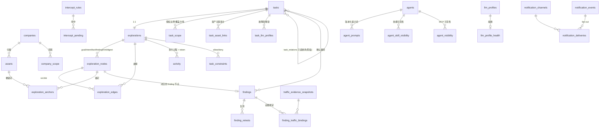

# ARTEX 技术架构分析报告

> 分析对象：`H:\Hiive\.reference\ARTEX`（AGPL-3.0，AI 自主渗透测试系统，Go 后端 + Next.js 前端）
> 分析方式：全部结论均来自实际读代码（read/grep/glob），关键处标注文件路径与行号。
> 用途：为「AI 渗透测试平台」毕业设计定架构。

---

## 0. 结论速览（先看这一页）

**它是什么**：一个 **LLM 多 agent 驱动的自主渗透系统**。用户给一个目标，系统自动分解目标 → 派发探索意图 → 用真实工具（Kali/Bash/HTTP）执行 → 把结果写回知识图谱 → 再规划下一轮，直到目标被证明达成。

**三个真正的核心机制**（其余都是围绕它们的工程外壳）：

1. **双图架构**：**资产图**（全局共享的资产真值库：root_domain/subdomain/ip/service/app/endpoint）+ **探索图**（每任务独立的过程图：goal/intent/fact/finding/hint/digest，用 `spawns/derived_from/yields/proves` 边连成血缘链），两图靠 `exploration_anchors(node_id, asset_id)` 锚定。见 `README.md:354-390`、`db/schema.sql:40-296`。
2. **单意图生成者 + 执行者分离**：`planner` 是**唯一**的意图生成者且**从不亲自干活**；`worker` 只领一条意图、执行、写回、即停，**从不自作主张扩大方向**。见 `agent/planner.go:298`、`agent/worker.go:230`。
3. **事件驱动闭环 + 跨唤醒共享 todolist**：图一变（debounced）就唤醒 planner；planner 每轮是**全新会话**（无状态），但通过一份按任务保留的 `TodoStore` 把串行利用链「记一次、分多轮逐步派」，从而在无状态会话下依然能走完 `注入点→取凭据→横向→提权` 这类强依赖链。见 `agent/planner.go:43-49, 106-144, 433`。

**规模**：非 SDK 部分 Go 327 文件 / **85,008 行**（其中测试 153 文件 / 27,538 行）；`norma/`（agent SDK，被 `go.mod` 用 `replace` 拉进源码树）206 文件 / 34,209 行（生产 18,471 + 测试 15,556）；前端 187 个 ts/tsx（TSX 152 + TS 35）/ **56,088 物理行** / 27 个页面；数据库 **49 张表**（`db/schema.sql` 1,386 行）。

**给毕业设计的一句话定位**：这份代码有 119k 行，但**真正的思想密度集中在不到 5k 行里** —— `agent/planner.go` 的规划提示词与去重规则、`agent/worker.go` 的写回纪律、`server/engine.go` 的闭环与状态机、`norma/skill/skill.go`（**整个技能系统的实现只有 331 行**）、`norma/compaction/compaction.go` 的摘要与技能重注入。**读这 5k 行，砍掉其余 114k 行，就是一个优秀毕设的骨架。**

**最重要的一个风险提示**：`go.mod:3-6` 明确写着 —— 上游 `github.com/Autumn-27/norma` 已闭源，本仓库是把 v0.4.3 从 Go module proxy 里 restore 回 `./norma` 再用 `replace` 引用的。**整个 agent 运行时（会话循环、工具调度、权限、压缩、transcript）都在 norma 里**，34k 行。这意味着：ARTEX 自身的 85k 行是「业务层」，而真正的 agent 内核你不能当第三方库依赖，只能读它、抄它或重写它。**这是毕业设计选题时最需要先想清楚的一件事。**

**另一个提示**：代码注释大量引用 `docs/§4.2`、`docs/LLM轮询设计.md`、`docs/任务级超时与收尾设计.md` 等设计文档，但**本备份仓库的 `docs/` 目录只剩 1 个文件**（`docs/漏洞流量证据.md`）。设计文档已丢失，所有设计意图只能从代码与注释里还原。

---

## 1. 总体架构

### 1.1 进程模型：单进程、单二进制、三合一

```
./artex  （单进程）
├── HTTP 服务            net/http，默认 :8787  —— 同时提供 REST API + SSE + 内嵌前端静态资源
├── MITM 记录代理         go-mitmproxy，默认 :8788  —— agent 的 HTTP 流量全量留痕
├── Engine 调度器         每任务 1 个 planner goroutine + N 个 worker goroutine（默认 3）
├── Manager              任务 / 引擎 / store / 流量 / enrich 的生命周期托管
└── 后台子系统            通知 dispatcher、agent 触发器调度器、enrich 线程池、自更新 bootstrap
```

- 入口：`cmd/artex/main.go`（156 行），`cmd/artex/main.go:110-115` 构造 skill 目录并 `server.New(ctx, mgr, skillDir, dataDir, baseDir)`。

**启动顺序**（`cmd/artex/main.go`，逐段）：
1. `:54-59` 解析 flag（`-addr :8787` / `-data <BaseDir>/data` / `-proxy 127.0.0.1:8788`，**proxy 传空串即禁用流量录制**）
2. `:63-65` `server.BuildVersion = version`（release 由 `-ldflags -X` 注入）→ 打印 banner
3. `:69` `server.StartLogCapture()` —— **先于一切**开始捕获日志（同时仍写 stderr），让日志页能看启动过程
4. `:75-79` `selfupdate.Bootstrap()` —— **必须在开库/绑端口之前**；返回 `Restart` 时直接 `return ExitRestart(75)`，由守护脚本完成换装
5. `:93-96` 信号处理（`signal.NotifyContext`）→ **刻意派生一个独立的 `shutdownContext`**，避免父 ctx 的 `context.Canceled` 抢在取消原因附加之前赢下竞态，导致运行中的 Agent 丢掉诊断原因
6. `:98-102` `server.NewManager(dataDir, proxy)` —— **DB 迁移都在这里**（`pgdb.Open` → `RecoverFindingRetests` → `EnsureLLMRecordsTable` → `EnsureLLMUsageTable` → `intercept.New(pg)` → `traffic.Open+Start` → `enrich.New`），main.go 自己不做迁移
7. `:107-108` `AfterFunc(30s, selfupdate.Settle)` —— **活过 30 秒才算新版本稳定**，标记才会被清
8. `:110-127` `server.New(...)` + `http.Server{ReadHeaderTimeout: 10s}`（**只设这一项**，以便 SSE/流式长连接）+ `ListenAndServe`
9. `:132-144` 退出：信号 → 退出码 0（脚本停止循环）；`RestartRequested` → 退出码 75（脚本重新拉起）+ 5 秒限时 `Shutdown`
- **前端内嵌**：`server/webui_embed.go:1` 的构建标签 `//go:build embedui` + `//go:embed all:webui/dist`。不带该 tag 编译时 `webui_stub.go`（15 行）让 webui 处理器直接 404，此时要单独跑 `next dev`。
- **数据库**：PostgreSQL（`github.com/jackc/pgx/v5`，`go.mod:14`）。`db/schema.sql`（1386 行）随二进制 `go:embed`，**每次启动幂等重跑**（大量 `CREATE TABLE IF NOT EXISTS` + `ALTER TABLE ... ADD COLUMN IF NOT EXISTS` + `DO $$ ... $$` 条件迁移），即「重启即迁移」，见 `README.md:151`。
- 另有 **SQLite sidecar** 只服务流量索引（`traffic/traffic.go:37` 引入 `modernc.org/sqlite`，用于 FTS5 全文检索），与主库分离。
- `start.sh` / `start.bat` 是**守护脚本**，按退出码决定是否重新拉起进程 —— 页面上的「一键更新」靠它完成二进制换装（`selfupdate/` 用 `exit 75` 协商换装）。

### 1.2 HTTP 服务

- 用 Go 1.22+ 的 method-pattern `http.ServeMux`（`mux.HandleFunc("GET /api/...")`），全部路由集中在 `server/server.go` 的 registerRoutes（约 `server/server.go:230-943`）。
- 两层 mux（`server/server.go:935-942`）：
  ```go
  api := cors(s.requireAuth(mux))   // /api/* 走 CORS + JWT
  root.Handle("/api/", api)
  root.Handle("/", s.webuiHandler()) // 其余由内嵌前端处理（无 JWT，客户端路由兜底 index.html）
  ```
- 鉴权：JWT（HS256，密钥持久化在 `data/jwt.key`，`db/nkey.go`），前端存 `localStorage.artex_token`，`server/auth.go:273`。首次进入 `/setup` 设管理员密码。
- 反向代理部署只需开 443（REST 与 SSE 同源同端口），但**必须 `proxy_buffering off`**，否则 SSE 会「连上但收不到事件」（`README.md:231-258`）。

### 1.3 前端如何与后端交互：**内嵌静态导出 + REST + SSE**（**没有 WebSocket**）

| 维度 | 事实 | 证据 |
| --- | --- | --- |
| 框架 | Next.js **16.2.9** App Router + React **19.2.7** + Tailwind **4.1.5**（**无 tailwind.config**，CSS-first）+ shadcn（`components.json` style=`radix-nova`）+ Biome 2.5 + husky | `web/package.json:22-80`、`web/next.config.mjs:10-20` |
| **源码根** | **`web/src/app`（不是 `web/app`）**；`tsconfig.json` 把 `@/*` 映射到 `./src/*` | `web/tsconfig.json:21-23` |
| 构建 | `build:static` = `NEXT_EXPORT=1 next build` → `output:"export"` + `trailingSlash:true` → `web/out` | `web/package.json:8`、`web/next.config.mjs:21-27` |
| 内嵌 | `cp -r web/out server/webui/dist` → `go build -tags embedui` | `README.md:120-128` |
| 数据 | REST `/api/*`，统一封装在 `web/src/lib/api.ts`（1316 行），`http()` 自动带 `Authorization: Bearer` | `web/src/lib/api.ts:114-148` |
| 实时 | **SSE / EventSource**，无 WebSocket | 见下 |
| Mock | `NEXT_PUBLIC_MOCK=1` 整站走内存 mock，无需后端（在线 demo 用这个）；共 **9 处**独立短路（`http()` 内 1 处 + 上传/下载/报告等裸 fetch 8 处）；`web/src/lib/mock/handler.ts` 有 **89 个精确 `path ===` 分支**，未命中返回安全默认 | `web/src/lib/api.ts:115,442,867…`、`web/src/lib/mock/handler.ts` |

**SSE 的 4 个端点**（前端）：
- `/api/exploration/activity/stream?task=<id>` —— 任务执行实时活动流（`web/src/app/(main)/function/tasks/detail/_tabs/sessions-tab.tsx:972`）
- `/api/logs/stream` —— 后端日志页（`web/src/app/(main)/system/logs/page.tsx:67`）
- `/api/side-questions/{id}/events` —— 旁路提问 `/btw`（`web/src/hooks/use-side-questions.ts:131`）
- `/api/update/stream` —— 一键更新的进度推送（`web/src/app/(main)/system/settings/_components/update-card.tsx:103`）

**SSE 的三个设计细节（很值得抄）**：
1. 服务端发标准 `id: <activityID>\ndata: {...}\n\n`（`server/server.go:3019-3023`），浏览器自动在重连时回传 `Last-Event-ID`，服务端**优先用该头**而非 query 参数，从而精确续传（`server/server.go:2996-3005`）。
2. **先订阅、后回放**：先 `Broadcaster.Subscribe(task)` 再分批（500/批）从 DB 回放 `since` 之后的历史，用 `id <= since` 去重，保证「回放与实时」之间不丢事件（`server/server.go:3012-3048`）。
3. **内存广播是有损的**（订阅通道满即丢，`server/broadcast.go:49-61`），但 **DB 是 source of truth**，客户端断线重连靠 cursor 补齐。20s 一次 ping 保活。

**SSE base URL 的坑**（已在代码里注释说明）：生产同源（空 base），开发必须**直连 :8787**，因为 Next 的 `/api` rewrite 会缓冲流式响应导致「EventSource 打开却 0 消息」；可用 `NEXT_PUBLIC_SSE_BASE` 覆盖（`web/src/lib/api.ts:150-198`）。

**开发态**：`./dev.sh` 起后端(:8787) + 流量代理(:8788) + `next dev`(:5173)，`next.config.mjs:35-38` 把 `/api/:path*` rewrite 到 `AUTOPENTEST_API`。

---

## 2. 目录职责表

| 目录 | 一句话职责 | 关键文件 |
| --- | --- | --- |
| `agent/` | **Agent 业务层**（9,285 行）：goals 目标分解器、planner 规划者、worker 执行者、mainagent 人在环路接口的 prompt 与运行装配；把双图暴露成 LLM 领域工具（`ToolSet`）；含上下文压缩（compaction/coldgraph）、跨任务黑板（relatedTaskOverviews）、工具目录（toolcatalog）。 | `planner.go`(473) `worker.go`(535) `tools.go`(2054) |
| `cmd/` | 进程入口。仅 `cmd/artex/main.go`(156 行)：解析 flags、加载配置、迁移 DB、起 Manager/Server、注册自更新 bootstrap。 | `cmd/artex/main.go` |
| `config/` | 配置加载（217 行）：`config.json` / 环境变量的解析，`SkillDir()`、`BaseDir()` 等路径解析。 | `config/config.go` |
| `db/` | **数据访问层**（96 文件 / 27,789 行）：`schema.sql`(1386) 是唯一 schema 真源；按域拆分的 store（assets/companies/tasks/exploration/findings/notification/intercept/skill_usage/tool_usage…），pgx 直写 SQL，无 ORM。 | `schema.sql` `exploration.go`(1882) `assets.go`(1429) |
| `docs/` | **几乎为空**：只剩 `docs/漏洞流量证据.md`(8.8KB)。代码注释引用的架构设计/LLM 轮询/超时收尾设计文档均不在本仓库。 | `docs/漏洞流量证据.md` |
| `enrich/` | **非 AI 的资产自动补全**（264 行）：异步线程池，用 dnsx 解域名、经记录代理探 HTTP，把 IP/端口节点与解析边写回资产图。 | `enrich/enrich.go` |
| `evidence/` | **漏洞证据固化**（756 行）：把漏洞相关的流量快照独立保存，使「流量记录被清理」不会连带毁掉漏洞证据。 | `evidence/store.go` |
| `guard/` | **工具调用安全闸**（212 行）：实现 `PreToolUse`/`PostToolUse` hook，调 intercept 规则判定、记录审计、做失败归因（blocked/error/ok）。 | `guard/guard.go:57-124` |
| `intercept/` | **审批规则与人在环路**（1,390 行）：规则匹配（工具名/入参/正则）、`allow/deny/ask` 裁决、pending 落库与阻塞等待人工决策、**LLM 兜底裁判**（judge）及其提示词契约。 | `intercept.go`(689) `prompt.go`(205) |
| `llmpool/` | **多 LLM 配置的故障转移池**（840 行）：链式轮询、安全窗口内 failover、熔断（health）、上下文窗口不匹配跳过、同优先级轮转。 | `llmpool/pool.go`(299) `health.go` |
| `llmrec/` | **LLM 调用录制与计量**（712 行）：`llm.Provider` 装饰器，逐次记录 token 用量（永远开）与完整请求/响应正文（可关），并通过 RoundTripper 抓原始 wire 报文。 | `llmrec/llmrec.go`(388) |
| `mcphttp/` | **远程 MCP 客户端**（646 行）：把 Streamable HTTP / 旧版 SSE 的 MCP server 适配成 `mcp__server__tool` 形状而不改 SDK。 | `mcphttp/client.go` |
| `norma/` | **内置 agent SDK**（206 文件 / 34,209 行），被 `go.mod` 的 `replace` 引入：`agentcore`(会话循环) `harness`(真正的 run 引擎) `llm`(三种协议) `tool` `permission` `hook` `compaction` `skill` `memory` `transcript` `noa`(实验性压缩) `subagent` `mcp`。**agent 的真正内核在这里，不在 `agent/`。** | `norma/harness/query.go`(882) |
| `notify/` | **漏洞 IM 推送适配层**（26 文件 / 4,029 行）：钉钉/飞书/企业微信/通用 webhook/Telegram/邮件 六种渠道的签名、UTF-8 截断、过滤匹配；纯叶子包，不依赖 DB/server。 | `notify/notify.go` |
| `report/` | **交付报告渲染**（260 行）：从探索图渲染 Markdown 汇总报告，以及 findings 的汇总/单条 Markdown / CSV 导出。 | `report/report.go` `report/findings.go` |
| `selfupdate/` | **页面一键更新**（1,161 行）：从 GitHub Release 下载 → SHA256 校验 → 冒烟测试 → 暂存 `artex.new` → 退出由脚本换装 → 失败自动回滚。 | `selfupdate/selfupdate.go` `stage.go` |
| `server/` | **HTTP + 调度 + 业务编排**（103 文件 / 32,114 行，最大的包）：全部路由与 handler、`Manager`（任务/store/流量生命周期）、`Engine`（planner/worker 调度、意图领取、暂停/终止/drain、任务级超时收尾）、SSE 广播、LLM 任务链路由（`task_llm.go`）、agent 工具装配（`assembly.go`）、通知编排、归档。 | `server.go`(3908) `manager.go`(1725) `engine.go`(1245) |
| `sidequestion/` | **旁路提问 `/btw`**（1,260 行）：不干扰主 run 的「快速问一句」通道，有自己的快照/上下文预算/校验，一次 completion 出答案。 | `sidequestion/service.go` `context.go` |
| `skills/` | **技能库（文件系统）**：3 个技能：`api-recon`（前端接口侦察，含 8 个脚本）、`playwright-cli`（浏览器自动化，含 9 篇 references）、`scopesentry`（ScopeSentry MCP 使用指南）。 | `skills/*/SKILL.md` |
| `traffic/` | **记录型 MITM 代理**（10 文件 / 3,917 行，其中测试 1,551 行）：内嵌 go-mitmproxy，把每个 HTTP 交换**全量写入 SQLite 索引库**（`<dataDir>/traffic/_index/index.sqlite`：`exchanges`/`exchange_bodies`/`blob_refs`/`ex_fts` 四表，FTS5 trigram 全文检索），超过 256 KiB 的 body 落**内容寻址 blob** 文件（`_blobs/sha256/<hash[:2]>/<hash>.bin`，内联留 8 KiB 预览）；提供 `traffic_search/get/blob` 三个只读 agent 工具。CA 由 go-mitmproxy 在 `<dir>/_ca` 首次生成。 | `traffic/traffic.go`(2130) `traffic/evidence.go` |
| `web/` | **前端**（187 ts/tsx / 51,907 行）：Next.js 静态导出 SPA，27 个页面、10 个任务详情 tab、REST 客户端 + SSE，含完整 mock 数据集供在线 demo。 | `web/src/app` `web/src/lib/api.ts` |

---

## 3. Agent 核心循环

### 3.1 四个角色与分工

| Agent（`agents.key`） | 角色 | 干的事 | 明确**不**干的事 |
| --- | --- | --- | --- |
| `goals` | 任务开局的一次性目标分解器 | 从目标/描述里抽**操作约束**（`set_constraints`）、登记**资产范围**（`add_task_scope`）、把目标拆成可核验的 goal 节点（`set_goals`）。MaxTurns=8 | 不做任何探测、不规划攻击步骤（`goals.go:19-46`） |
| `planner` | **唯一的意图生成者** + 目标判定者 | 读态势（预取 `graph_overview`）→ 判目标（`prove_goal`）→ 只在有**未覆盖的新方向**时派意图（`add_intent`）；可 `kill_work` / `steer_work` 干预在跑的 worker | **绝不亲自干活**（prompt 明确「本轮所有产物只能是生成/说清意图或判定目标」`planner.go:298`） |
| `worker` | **执行者**（×N 并发） | 领**一条**意图 → 用真实工具执行 → 边发现边写回（`insert_assets` / `record_fact` / `report_finding`）→ 一句话总结 → 停 | 不生成新方向、不追本意图之外的线索（只在 fact 里「点一句」交给规划者，`worker.go:230-243`） |
| `mainagent` | **人在环路接口** | 与人对话；观察（读工具）、操舵（`add_hint` 战略提示 / `add_intent` 直投意图 / `steer_work` 实时纠偏 / `set_goals` 补目标 / `set_constraints` 补约束） | 不跑自主意图生成循环（那是 planner 的），`mainagent.go:16-19` |

### 3.2 一次探索的闭环（引擎侧）

`server/engine.go:748-960`：

```go
func (e *Engine) Run(ctx, t *Task) {
    rt := e.registerTaskRoutines(ctx, t.ID, 1+workers)
    runTaskRoutine(rt, plannerLoop)          // 1 个 planner
    for i := 0; i < workers; i++ { runTaskRoutine(rt, workerLoop) }  // N 个 worker（默认 3）
    e.startDeadlineCoordinator(ctx, t)       // 任务级超时定时器
    if has, _ := t.Store.HasActiveIntent(); !has { t.Notify() }  // 只在完全没活时才 kick 首轮规划
}
```

**plannerLoop**（`engine.go:800-914`）：
1. 阻塞等 `t.notify`（边沿：worker 结束 / finding / kill / resume）或心跳定时器（默认 300s，最低 600s 归一，`db.MinPlanHeartbeatSeconds`）。
2. 被唤醒后先 **debounce**：把一串连续变更合并成一轮（`engine.go:811-819`）。
3. 一串 guard：LLM 未就绪 / 已暂停 / 删除中 / 任务终态 / 任务超时收尾中 → 全部直接 return。
4. **goalless 分支（纯 Go，不烧 LLM）**：任务已无 open goal（人工直投场景）→ 若还有 open/running 意图就静默等待，抽干了就落 `done`（`engine.go:845-858`）。
5. 进入 `planner.Plan(...)`，`triggers`（本轮到底是什么变了）从 `t.drainTriggers()` 取出。
6. 返回 `met=true` → 任务状态置 `done` + **立刻 `cancelExec` 取消所有在跑的 worker**（`engine.go:885-894`）。

**workerLoop**（`engine.go:916-960`）：循环 `claimNext`（`Frontier(20)` 里 CAS `open→running`，`engine.go:1237-1245`）→ 无活可领则 sleep 800ms → 有则跑 `runIntent`。

**runIntent**（`engine.go:982-1157`）是最完整的一个函数，串了：per-work child ctx（供 planner `kill_work`）→ 注入 `intercept.WithTaskContext` → 包一层 `steerHooks`（让 `steer_work` 能在 worker 下一次工具调用前插入纠偏，并带「空转提醒」）→ `worker.Execute` → `model_error` 退避重跑 → 按取消原因/终态分流意图状态。

### 3.3 planner 怎么决定下一步

每轮 `Plan()` 都是一个**全新 session**（`planner.go:355-472`），但输入被精心组织过：

- **态势预取**：`graph_overview` 的 JSON 直接拼进本轮 user 输入（`renderGraphOverview`，`planner.go:287-293`），省掉一次工具往返——因为「每轮上下文都是空的，第一件事必然要读态势」。
- **触发点前置**：`renderTriggers` 把本轮到底变了什么写清楚（某意图跑完 + 它的输出结论 + 它新产出的 fact id 列表；某 worker 报了 finding；人加了 goal/hint；人删了意图及原因），`planner.go:173-215`。
- **提示词里的硬底线**（`planner.go:303-305`）：**只要「目标未达成」且「当前没有任何 open 或 running 意图」，本轮必须至少产出一个意图** —— 否则任务停摆。此外产出 0 意图是**正常且被鼓励**的结果，但必须有正当理由（已覆盖 / 等依赖）。
- **去重要求**：新方向必须与 `open_intents + running_intents + recent_done_intents` 逐一比对；`recent_done` 里出现过的**不原样重派**，且要看它的 `state` 分辨怎么停的：`done`（跑完了，除非有「材料性新机理」否则不重派）/ `exhausted`（预算耗尽被掐断，可「接上次进度继续」）/ `blocked`（外部故障没跑成，可直接重派）。
- **串行链分步派**：`TodoWrite` 记整条链，**本轮只派「前置已满足」的那一步**，等它产出 fact 后下次唤醒再派下一步（`planner.go:333`、`renderPlannerTodos` `planner.go:129-144`）。
- **目标判定**：只靠逐个 `prove_goal(goal_id, evidence_id, reason)`；**标记最后一个未达成目标为 met 时系统自动判定整个任务完成**，prompt 里明确「没有别的『一键完成』手段」（`planner.go:315`）。对被否定/存疑的 fact 要求先 `node_detail` 看 evidence，evidence 不足的按「尚未探明」处理并**最多复核一次**。
- **明确禁止 planner 自己探测**：只有当图里几乎还没 fact 时，允许 ≤3 次只读探测（如 curl 看首页），唯一合法产物是「一句更精准的意图描述」，一旦图里已有 worker 产出的事实就禁止再自己探测（`planner.go:318-321`）。

### 3.4 worker 怎么执行与写回

`worker.Execute`（`worker.go:349-535`）：
- 意图块（`renderIntentTask`）放进 **system prompt**，理由写得很清楚：意图是整个 run 的**不变量**，system 每次 run 重新拼装、**绝不会被 compaction 压掉**，长 run 里意图永远在场；代价是丢掉跨意图的缓存复用 —— 这是刻意的取舍（`worker.go:384-390`）。
- 全局态势 overview 放**启动 user 消息**（可降级、容忍 stale，压掉无碍），并且**主动删掉 `coverage` 字段**（覆盖度是给规划者的信号，与 worker「只做领到的那条意图」的职责相悖，`worker.go:325-338`）。
- 工具面刻意收敛：worker **不给** `MultiEdit/Glob/Grep`（`defaultToolsExcept`，`worker.go:379`）——文件精改用 Edit、检索走 Bash，减少低价值调用。
- 三种写回严格分图：`insert_assets`（资产图）/ `record_fact`（探索图，默认一条、能并进 detail 的都并进去）/ `report_finding`（只在**本次真实触发并拿到可复现证据**时用；「版本匹配 CVE」「参数看起来可注入」明确禁止当 finding，`worker.go:237-240`）。
- 写回统计 `WriteCounts{Facts, Assets, Findings}`（`tools.go:139-161`），让引擎能区分「探了但什么都没写回」和「真的完成了」。
- `report_finding` 落库时**当场唤醒 planner**（`notifyFinding`），不等 worker 跑完，planner 立刻知道「哪个意图发现了什么」（`worker.go:342-348`、`tools.go:130`）。

### 3.5 上下文如何压缩（三层）

| 层 | 机制 | 触发 | 位置 |
| --- | --- | --- | --- |
| **① SDK 会话压缩** | 滑动窗口摘要：超阈值时保留最近尾部、把前面的历史换成摘要消息，并把**技能调用消息原样重注入** | 按 `ContextWindow` 阈值（默认 200K，夹逼到 [32K,1M]） | `norma/compaction/compaction.go`（431 行）、`agent/provider.go:105-136` |
| **② 冷节点折叠（cold-digest）** | **对探索图本身做压缩**：把「已连续 ≥R=6 轮无下游活动」的冷节点按连通性分组（≥K=2），用 LLM 压成一段综合结论 body（保留出处 id），写成一个 `kind=digest` 节点 + `covers` 边；planner 态势里平铺列表不再重复显示被折叠成员，改读 `cold_digests`；需要细节时 `expand_digest` 展开 | planner 每轮 `OnPlannerRound` 维护冷标记（纯记账、不调 LLM）；未压缩冷节点 ≥N=20 触发 minor，活跃 digest ≥M=8 触发 major；每任务同时只压一个、冷却 60s、单次上限 5min | `agent/compaction.go`(548) `agent/coldgraph.go`(330) `db/digest.go`(239) |
| **③ noa（实验性）** | 开关式把上下文压缩整体交给 `norma/noa`（9,017 行），归档持久化到 `<workDir>/noa/<SessionID>` | 系统设置开关 | `agent/noa.go:37`、`norma/noa/` |

**②的设计亮点**：它是「**图级压缩**」而非「对话级压缩」。压缩单位是**语义连通的子图**，摘要有 `generation`（重摘代次）与 `signature`（变更检测），major 时**回源重压**：签名未变的块直接复用旧 digest（不调 LLM），过期的先 supersede 再重建；写入时还有**提交期 liveness 复检**，把压缩期间「复活」的节点从 covers 集合里剔除，保证 digest 永远不会覆盖热节点（`agent/compaction.go:252-282`）。

### 3.6 任务何时终止

**两层终止，语义严格分开**（这是这个项目很值得学的一点）：

**A. 单次 run 的终止** → `harness.TerminalReason`（`norma/harness/event.go:38-48`，11 种）+ **收尾阶段（Settlement）**：
- 11 种取值：`completed` / `max_turns` / `timeout` / `model_error` / `prompt_too_long` / `stop_hook_prevented` / `aborted_streaming` / `aborted_tools` / `blocking_limit` / `image_error` / `hook_stopped`。
- ⚠️ **其中 3 种「定义了但主循环从不产出」**：`blocking_limit`（`event.go:39`）、`image_error`（`:40`）、`hook_stopped`（`:46`）。**你若照抄后按它们分支，就是死代码**。
- `aborted_streaming` 与 `aborted_tools` 的区别：前者是模型流式阶段被取消；后者是工具执行阶段被取消。而 `timeout` 是**宿主设定的墙钟预算**（`MaxDuration`）命中 —— 既包括轮边界检查，也包括 `toolCtx` deadline **打断在飞的工具**（`harness/query.go:221-228` 用独立的 `toolCtx` 派生 deadline：**打断工具但绝不切断模型流**）。
- 撞到 `max_turns` 或 `timeout` 时，SDK **不是直接杀**，而是进入**收尾阶段**：把收尾提示词作为一条 **user 轮**注入（隐藏 `DisabledTools` 的 schema，典型隐藏 `Bash`），让 agent 先「把已识别但没写回的内容落库」再输出一句总结。收尾提示词按 agent 可后台编辑（`agents.wrapup_prompt`），但**禁用哪些工具是代码固定策略**，用户改不掉（worker 收尾禁 Bash，`agent/wrapup.go:90-100`、`worker.go:425`）。
- **收尾结束仍以原预算原因收尾**（`max_turns`/`timeout`），**永远不会变成 `completed`**（注释理由见 `norma/harness/query.go:99-104`）—— 这是「预算耗尽 ≠ 正常完成」在 SDK 层的贯彻。
- 项目还做了**任务级超时收尾词**与 per-run 收尾词的分离：planner 的两套词语义**相反**（per-run 说「别停继续规划」，任务超时说「到点停止规划、做最后判定」），用 `PromptByReason` 在收尾时按实际 reason 现场挑（`agent/wrapup.go:102-173`）。

**B. 意图（intent）状态机**（`db/schema.sql:187`）：`open → running → {done, blocked, exhausted, stopped, paused, deleted}`。分流规则在 `engine.go:1133-1152`：
- 正常跑完 → `done`
- 撞步数/时长上限 → **`exhausted`**（"试过但没真正做完、需换角度"，不是完成也不是失败 —— 这个第三态是让 planner 不把半途而废当"已覆盖"的关键）
- 出错 → `blocked`（写 `blocked_reason`，LLM 额度耗尽时标 `IntentBlockedLLMQuota`）
- planner `kill_work` → `stopped`
- 用户暂停 → 回退 `open`（重新领取时会从 transcript **续跑**而不是从头开始）
- 任务已完成时被取消 → `stopped`（不污染已完成任务的意图状态）

**C. 任务级终止**（`tasks.status`：`created/running/paused/done/failed/timeout`）：由**最后一个 open goal 被 `prove_goal` 标记 met** 触发（`engine.go:885-894`）；或任务级 deadline 到点由 deadline 协调器（`server/engine_timeout.go`）走收尾时序 `settling`（停止派/领新意图 → 等在跑 run 自然收尾 → 落终态）；或人工暂停/删除。

### 3.7 Blackboard（跨任务共享）与过程级信息交换

**这里有两套不同的「信息共享」，别混为一谈**：

**① 跨任务只读黑板（黑板的真身）**：`task_relations(task_id, source_task_id)` 建立**一层、非递归**的只读继承；`graph_overview.related_tasks` 字段把源任务的 goal/hint/fact/finding/intent 摘要按**预算裁剪**后注入（总 48,000 runes、每源 ≤8,000，超预算降级截断且标注 `truncated`），并强制标 `inherited:true`。设计上刻意：源任务的意图**绝不会进入本任务的 frontier**，不会被误当成本地可领取的活；继承提示也**不能**作为漏洞证据绑定来源（`agent/tools.go:658-749`、`finding_workflow.go:114`）。相关测试：`agent/blackboard_inheritance_test.go`(437 行)。

**② 同任务内 worker 之间以「执行过程」为粒度交换**（`README.md:419-436`）：
- `search_all_worker_traces(q)`：在**本任务其他 work 的执行过程**里按关键字检索（自动排除自己那条意图），命中项带 `intent_id`；
- `list_worker_traces` / `get_worker_trace(intent_id, step_ids=[…])`：先看有哪些 work 跑过，再取某个 work 具体几步的完整内容。
- 用途：一次深入探索里大量有价值的观察（报错、隐藏参数、响应片段）出现在**执行过程**中而没被写成正式 fact；这套工具让后续 worker 能复用前人过程，边界不变（每个 worker 仍只做自己那条意图）。
- 实现：`agent/tools.go:1818-2030`（trace 工具）、每步的 `activity` 表即过程库。

---

## 4. 工具层

### 4.1 工具从哪来（四类）

| 类别 | 来源 | 举例 | 是否入 `tools` 表 |
| --- | --- | --- | --- |
| ① SDK 通用工具 | `actool.DefaultTools()`（`norma/tool/registry.go:62`） | `Bash` `Read` `Write` `Edit` `MultiEdit` `LS` `Glob` `Grep` `Sleep` `TodoWrite` `WebFetch` `web_search` `AskUserQuestion` `Monitor` `TaskList/TaskOutput/TaskStop` | **不入表**（每个 agent 固定拥有，DB 不改），`toolcatalog.go:30-33` 有明确理由 |
| ② 领域工具（双图操作） | `agent/tools.go` + `tools_insert.go` + `tools_digest.go` | 见下表 | **入表**，可按 agent 绑定、可改描述/schema |
| ③ 宿主工具（host tools） | 运行时由 server 注入 | `traffic_search/traffic_get/traffic_blob`（流量录制开启时）、编排工具、Auto agent 的平台工具（`create_skill`/`create_custom_tool`/`create_mcp`/`delete_assets_by_host`） | 入表（traffic 三件套默认绑 worker） |
| ④ MCP / Skill 工具 | `mcphttp` / `norma/mcp` / `norma/skill` | `mcp__<server>__<tool>`、`Skill` 元工具 | 不入表，原样放行 |

### 4.2 领域工具清单（按 agent）

**worker（`tools_insert.go:644-661`）**：`list_findings` `report_finding` `record_fact` `insert_assets` `list_assets` `search_all_worker_traces` `get_worker_trace` `node_detail`
> 刻意**不给** worker：`list_facts` / `list_companies` / `list_worker_traces` / `add_company_scope`（读上下文与跨 work 复盘是规划职责）。

**planner（`tools.go:2033-2053`）**：`graph_overview` `list_findings` `list_facts` `node_detail` `expand_digest` `get_worker_output` `get_worker_trace` `search_all_worker_traces` `list_goals` `add_intent` `prove_goal` `goal_met` `kill_work` `steer_work` `report_finding` `list_companies` `list_assets` `add_company_scope` `add_task_scope` `list_untested_assets`

**mainagent（`tools_insert.go:664-682`）**：`graph_overview` `list_findings` `list_facts` `node_detail` `expand_digest` `get_worker_output` `get_worker_trace` `search_all_worker_traces` `add_hint` `add_intent` `steer_work` `set_goals` `set_constraints` `insert_assets` `add_company_scope` `list_assets` `report_finding` `record_fact` `add_task_scope` `list_untested_assets`

**goals（`toolcatalog.go:42`）**：`set_goals` `set_constraints`（+ 有 asset store 时 `add_task_scope`）
**auto（内置「平台运维」agent）**：`report_finding` `insert_assets` `add_company_scope` `list_assets` `list_companies` + 7 个平台工具
**pentest（独立渗透 agent）**：`list_assets` `insert_assets` `report_finding` `list_findings` `list_companies`

**工具分类归纳**（27 个领域工具）：
- **只读/态势**（7）：`graph_overview` `list_findings` `list_facts` `list_goals` `list_assets` `list_companies` `list_untested_assets`
- **详情/回看**（5）：`node_detail` `get_worker_output` `get_worker_trace` `list_worker_traces` `search_all_worker_traces` `expand_digest`
- **写探索图**（5）：`add_intent` `record_fact` `report_finding` `prove_goal` `goal_met`
- **写资产图**（3）：`insert_assets` `add_company_scope` `add_task_scope`
- **人/规划者操舵**（5）：`add_hint` `set_goals` `set_constraints` `kill_work` `steer_work`
- **流量取证**（3，host）：`traffic_search` `traffic_get` `traffic_blob`

### 4.3 工具如何注册 / 描述 / 授权

**注册与「可管理化」**（这是这个项目一个很有想法的设计，`agent/toolcatalog.go`）：

> 把「内置工具」从纯代码变成**可枚举、可被 DB 覆盖的目录**。key 与 handler 永远来自代码，DB 只能改「模型看到的散文与缺省入参」。

- 开机 `wireTools`（`server/assembly.go:212-234`）把每个内置工具的 `Name/Description/InputSchema/默认绑定 agent` 幂等播种进 `tools` 表（`ON CONFLICT DO NOTHING`，**不覆盖用户在页面上的编辑**，也不清理用户自建的自定义工具）。
- 运行时 `agent.ToolResolve`（`server/assembly.go:239-324`）在工具装配的最后一步介入：按 `tools` 行**过滤**（未启用 / 未绑定给该 agent → 丢弃）+ **包装**（`DecorateTool`，`toolcatalog.go:113-137`：`Description()`/`InputSchema()` 返回 DB 覆盖值，`Call()` 前先 `injectDefaults` 注入 scalar 默认值）。
- 工具可以**被注入**：DB 里绑给某 agent 但基础列表里没有的领域工具会被追加进去（覆盖 `Auto`/自定义 agent 的空白，`assembly.go:274-289`）。
- `defaultUnbound`（`toolcatalog.go:59`）：`goal_met`（绕过逐个 prove_goal 直接宣布整个任务完成）权重太大且有误判风险，**默认不绑任何 agent**，需要时手动绑。
- `kind="shell"` 的 DB 行**不是工具**，而是「环境声明」，会被拼成一段 `以下工具已安装在此 bash 环境中` 追加到 `Bash` 的描述里（`assembly.go:290-307`）。
- 描述还会按功能开关**动态改写**：`findingWorkflowTools`（`agent/finding_workflow.go:25-83`）在「流量证据绑定」开关关掉时**从 schema 里删掉** `traffic_refs`/`evidence_hint_id` 参数（在副本上改，回头开开关能恢复原 schema）。

**授权（两层）**：
1. **能力授权**：`tools` 表的 agent 绑定（决定模型**能不能看到并调用**这个工具）。
2. **执行授权**：`permission` 包 + hook + intercept 规则（决定**调用能不能真的执行**）——见下。

**延迟工具（deferred tools）**：MCP 工具默认只把**名字**放进 system prompt 末尾的 `<available-deferred-tools>` 块，schema 不外露；模型需先用 `SearchExtraTools` 拿 schema，再用 `ExecuteExtraTool` 调用；`UnlockSet` 决定哪些是可调的。这个块放在 system 的**最后一个 segment** 并用 `DynamicBoundary` 标记，使整段（session 固定）system prompt 可被缓存（`agent/deferred.go:10-27`，`norma/tool/deferred.go`）。

### 4.4 有没有沙箱 / 审批？—— **没有 OS 级沙箱；有「策略级」审批闸**

**必须说清楚：ARTEX 没有任何真正的进程/文件系统沙箱。** Agent 用 `Bash` 跑的是**宿主机的 shell**（Docker 部署时是容器内的 shell，容器里预装了 ripgrep/curl/vim/nmap/playwright 等）。它的「安全边界」完全是**策略级**的，由四层构成：

| 层 | 机制 | 位置 |
| --- | --- | --- |
| **① SDK 权限管线（实际被绕过）** | 6 种模式（`default/acceptEdits/bypassPermissions/plan/dontAsk/auto`），四阶段求值（**deny 规则绝对优先** → 模式短路 → allow 规则与只读放行 → 交互确认）。**但 ARTEX 的 worker/planner 一律用 `permission.ModeBypass`，等于把这一层完全绕过**，安全性全交给下面三层 | `norma/permission/permission.go:46-136`、`agent/worker.go:436`、`agent/planner.go:412` |
| **② Guard hook** | 每次工具调用必经 `PreToolUse`（**在权限判定之后**）：记录审计 → 交给 intercept 规则判定 → deny 就直接 block；`PostToolUse` 对 Bash 结果做失败归因（blocked/error/ok） | `guard/guard.go:57-163`；钩子调用点 `norma/harness/tools.go:77-83` |
| **③ 拦截规则（intercept_rules）** | DB 表：`match_target ∈ {tool_name, tool_input}`、`match_type ∈ {string, regex}`（regex 预编译失败**跳过该条而不崩**）、`action ∈ {allow, deny, ask}`、按 `priority DESC` **取第一条命中**（所以 allow 也能短路掉低优先级规则）、超时策略。可全局、可按任务，也可由任务模板预置。**只有进入「拦截启用工具集」的工具才走规则**（默认集：`Bash/WebFetch/web_search/shell_open/shell_send/Write/Edit/MultiEdit`） | `db/schema.sql:1033-1076`、`intercept/intercept.go:143-147, 165-208, 508-548` |
| **④ LLM 兜底裁判（judge）** | **仅当规则一条都没命中时**：一个独立 LLM 调用，把「`tool_name` + 完整 `arguments` +（仅当存在当前人类原文时）`background`」交给裁判模型，输出 `allow/ask/deny` + 三段式 comment（实际操作/成功后后果/命中规则编号）。默认 `timeout=15s`、`fail_action=allow`、`ask_timeout=300s`、`ask_timeout_action=deny`；`MaxTokens=1024`、`Temperature=0`、`Thinking=disabled` | `intercept/intercept.go:303-490`、`intercept/prompt.go:50-205`、`server/intercept.go:36-94` |

**「ask」（转人工审批）的完整链路**：`guard.preToolUse` → `interceptor.HandleAsk` → 写 `intercept_pending(status=pending)` → **阻塞等待** `pendingManager` 的 channel（容量 1，**只用于唤醒**）→ 有人在页面点允许/拒绝时 `Interceptor.Decide` **先改库、成功才唤醒**（库是唯一真相源；`resolved==false` 返回 `ErrAlreadyDecided` → HTTP 409）→ 超时按 `timeout_action`（默认 deny；`ask` 超时默认 300s）→ 返回 block 或放行。两个很细的竞态防护：① `HandleAsk` **注册 channel 之后会回读一次 DB**，防止「INSERT 已提交但 channel 还没注册」期间用户已决策而丢单；② 超时后发现已被人决策则**回读 DB 取真实结果**（`intercept/intercept.go:584-689`）。审批记录支持展开看详情（`README.md:51-54`）。

**几个很值得学的工程细节**：
- **拦截消息必须「去 WAF 化」**：`systemBlockMessage`（`guard/guard.go:126-141`）会把拦截原因包装成「**【ARTEX 平台管控·非目标防御】此调用被平台拦截。原因：… 此操作被禁止。**」。理由写在注释里且非常真实：裸的「禁止执行此工具」和目标的 403/WAF 长得一模一样，pentest agent 的本能是**绕过它**（改写命令、换 payload、重编码、重试）—— 既徒劳（平台拦的是**这一类动作**）又错误（这是策略决定，不是待攻克的障碍）。**只有面向模型的 tool_result 带这个前缀，审计/历史行保留原始原因**。
- **裁判输入的信任边界契约**（`intercept/prompt.go:10-18`）：明确声明输入里的提示注入文字**都是待审查数据**；不附带历史工具调用/结果/历史审批理由（只审当前调用，不推测此前执行情况）；不许因为路径像 `/srv` 就断言是生产资产。用户可自定义裁判策略，但 `JudgeContextBoundary` 与 `JudgeOutputContract` 由程序强制追加，**改不掉**。
- **裁判输出是严格解析的**（`intercept/prompt.go:162-205`）：用 `json.Decoder` 逐 token 校验（拒绝重复键、多余键、尾随字符）；会确定性地剥掉 ```` ```json ```` 围栏，但**故意不补全被 MaxTokens 截断的 JSON**（注释理由：补全等于「凭空发明模型没给的裁决」）；`comment` 必须在 2400 字符内且以「实际操作：」开头。失败策略：模型报错或输出不可解析 → 走 `fail_action`（**默认放行**）；但**「上下文无效」（参数不是合法 JSON）→ 无条件 `ask` 转人工**，不受 `fail_action` 影响。
- **MCP 工具默认要人工批准**：`mcphttp` 给每个远端工具装 `Permissions: AskUser("call MCP tool <full>?")`（`mcphttp/client.go:292-294`）—— MCP 工具与 worker 的绕过模式不同，走询问。
- **资产拦截规则**（独立于工具拦截）：`asset_intercept_rules`（全局）+ `task_intercept_rules`（任务级，含 `allow` 白名单语义）——匹配的是**目标资产**（域名/IP/URL 全等或模糊、CIDR），判定顺序是「先看拦截规则（全局 ∪ 任务 block），命中即禁；未命中且该任务存在启用的 allow 规则时，必须命中某条 allow 才放行」(`db/schema.sql:1259-1266`)。
- **失败归因（Observer / G5）**：把 Bash 结果分类成 blocked/error/ok 做统计（正则 `(?i)\b(403|forbidden|waf|blocked|rate.?limit|429|captcha|denied)\b`），让 planner 能在遇到 WAF 时换策略而不是原地重试（`guard/guard.go:143-163`）。
- **审计的 ID 关联是保守的**：`intercept.Trace` 只在「恰好一个候选」时才把 tool_use 与 tool_result 认领关联，否则标 `Correlation="ambiguous"`（注释：*Never guess between simultaneous identical requests, even when results arrive FIFO*）；`Finish()` 时未收到结果的调用一律标 `"unknown"`，**绝不标成功**（`intercept/trace.go:36-38, 89-115, 143-180`）。
- **工具输出有一道全局收口**：`harness/tools.go:126-133 capOutput` 对**所有**工具（内置/MCP/自定义/宿主）的文本块跑 `tool.CaptureOnce`，它用 `<persisted-output>` / `characters truncated]` 标记做幂等（`norma/tool/helpers.go:60-75`），保证任何工具都无法撑爆上下文。**这是毕业设计最该抄的一处**。
- 注意 `guard.go:3-7` 明确写了 **RoE 授权范围机制已被移除**，破坏性/外泄管控**不再硬编码**在 guard 里，而是变成 DB 里的【内置】拦截规则 —— 用户可以禁用或删除它们。**对毕业设计来说这是一个必须自己补回来的缺口**（见 §11）。

---

## 5. Skills 机制（重点详述）

### 5.1 目录结构与文件格式

**格式遵循 agentskills.io 开放标准**（`norma/skill/skill.go:1-5`）：每个技能是 `skills/` 下的一个**子目录**，核心文件是 `SKILL.md`，**YAML frontmatter + Markdown 正文**。

```
skills/
├── api-recon/                    # 技能 = 一个目录
│   ├── SKILL.md                  # 17.9 KB  ← frontmatter + 正文
│   ├── reference.md              # 19.5 KB  ← 附加参考（正文里用相对路径引用）
│   └── scripts/                  # 技能自带可执行资产
│       ├── harvest_static.py  runtime_harvest.js  preload.js
│       ├── build_perm_tree.py  extract_route_map.py  spider_mpa.py
│       └── package.json  package-lock.json
├── playwright-cli/
│   ├── SKILL.md                  # 12.3 KB
│   └── references/*.md           # 9 篇（test-generation 15.7KB、running-code、tracing…）
└── scopesentry/
    └── SKILL.md                  # 16.1 KB
```

**frontmatter 支持的字段**（`norma/skill/skill.go:245-257` 的 `frontmatter` struct）：

| 字段 | 必需 | 说明 |
| --- | --- | --- |
| `name` | ✔（规范） | 技能名。**缺失时回退为目录名**（`skill.go:232-234`） |
| `description` | ✔（规范） | 规范的**主要发现字段**，应当同时说明「做什么 + 何时用」（`skill.go:179-181`） |
| `license` | ✖ | 规范可选字段 |
| `compatibility` | ✖ | 规范可选字段 |
| `whenToUse` / `when_to_use` | ✖ | **历史遗留**，仅为兼容旧技能保留；新技能应把 when-to-use 揉进 `description` |
| `mcps` / `mcp` | ✖ | **本项目的扩展**：本技能加载时要**解锁**的 MCP server 名。支持标量（`"a"` 或 `"a, b"`）和 YAML 列表（`[a, b]` / 块状）两种写法（`stringOrList.UnmarshalYAML`，`skill.go:292-317`） |

实测的三份 frontmatter（原文）：

```markdown
---
name: api-recon
description: 收集网站API接口时调用该skill。
---
```

```markdown
---
name: playwright-cli
description: Automate browser interactions, test web pages and work with Playwright tests.
allowed-tools: Bash(playwright-cli:*) Bash(npx:*) Bash(npm:*)
---
```

```markdown
---

## name: scopesentry-mcp
description: 通过 ScopeSentry MCP 管理安全扫描平台（项目、任务、模板、资产、节点）。在用户提到 ScopeSentry、MCP、API Key、扫描任务、资产查询时使用。
```

> ⚠️ **第三个是坏的**：`---` 后跟空行再接 `## name: ...`，说明作者误把 Markdown 二级标题写进了 frontmatter。副作用：`## name: xxx` 在 YAML 里是**注释**，所以 `name` 解析为空 → 回退目录名 `scopesentry`；`description` 仍能解析（因为它不是注释）。**解析器按设计「坏 frontmatter 不丢弃技能、正文照常加载」**（`skill.go:259-262`），所以这个技能仍可用，只是名字与作者意图不符。**这是给毕业设计的一个真实教训：宽松降级是必要的，但要能暴露出来**（ARTEX 只在技能列表页显示解析出的字段，没有"frontmatter 解析失败"告警）。

**正文里可用的变量**：`${SKILL_DIR}` 会被替换成该技能的绝对目录路径（`skill.go:131-134`），所以技能正文可以写「跑 `${SKILL_DIR}/scripts/harvest_static.py`」这种自带脚本的指令。

### 5.2 加载：目录 → Registry（**每 run 按 agent 可见性现加载**）

```go
// norma/skill/skill.go:207-243  LoadDir(dir)
for _, e := range entries {
    switch {
    case e.IsDir():   // 子目录 → 找 <dir>/SKILL.md（存在才认）
    case strings.HasSuffix(e.Name(), ".md"):  // 也支持 skills/ 根下的裸 .md 文件（Dir = skills/ 本身）
    }
    s := parse(string(data))                  // frontmatter 用真 YAML 解析器
    if s.Name == "" { s.Name = 目录名去 .md } // 名字回退
    s.Dir = 该技能目录
    r.Add(s)
}
```

加载入口在 server 侧（`server/assembly.go:33-53`）：

```go
// wireAgentAugment 注册为 agent.ToolAugment，每次 agent run 装配工具时被调用
if names, _ := pg.AgentSkillNames(a.ID); len(names) > 0 {      // ← 查 agent_skill_visibility
    if allReg, err := skill.LoadDir(skillDir); err == nil {    // ← 全量从磁盘读
        reg = skill.NewRegistry()
        for _, s := range allReg.List() {
            // ★ 关键：按【目录名】匹配，不是按技能显示名 Name
            if s.Dir != "" && nameSet[filepath.Base(s.Dir)] { reg.Add(s) }
        }
        if len(reg.List()) == 0 { reg = nil }
    }
}
```

要点：
- **可见性是 per-agent 的**，存在 `agent_skill_visibility(agent_id, skill_name, enabled)` 表里；`skill_name` 存的是**目录名**（`assembly.go:44-45` 有明确注释）。
- **加载是「现读磁盘」**：没有常驻 Registry 缓存，每次 run 装配工具时重新 `LoadDir`。好处是**改文件即时生效、无需重启**；代价是每 run 一次全目录 IO（技能只有几个时无所谓）。
- 技能**未命中**（模型点名了一个不存在的技能）不会静默：会写一条 `skill_usage(found=false)` 账本行（见 5.6）。

### 5.3 技能如何被「选择」和注入（这部分设计得最细）

**选择 = 模型自主决定 + 一个元工具。** ARTEX **没有**任何关键词匹配、向量检索或路由表。机制是：

**(1) 目录清单常驻在 `Skill` 元工具的 `Prompt()` 里**

```go
// norma/skill/skill.go:100-113
Prompt: "Available skills:" + r.listing(),
```

`listing()`（`skill.go:174-202`）渲染成每行 `- name: description`，并且有**预算控制**：
- 单条 description 超 500 字符 → 截断加 `…`（`maxSkillDescChars = 500`）;
- 累计超 **8,000 字符** → **后续技能降级为「只有名字」**（`maxSkillListingChars = 8000`）;
- **技能永不丢弃** —— 因为「模型必须仍然能调用每一个」。这是一条很清醒的取舍：宁可让描述退化，也不能让能力消失。

`Prompt()` 在 norma 里是**每轮重新注入**的（不是 system prompt 的静态部分），所以这份清单**每个 turn 都在模型眼前**，且不会因为注册表变大而线性膨胀上下文。

**(2) 模型调 `Skill(name, args?)`**

- **权限**：`permission.Allowed()` 硬编码放行；`ReadOnly: true`、`Concurrent: false`（`skill.go:114-118`）。**技能调用不受 intercept 审批影响**（`IsToolEnabled` 默认工具白名单里没有 `Skill`，见 `intercept/intercept.go:143`）。
- **未命中**：返回 `Error: unknown skill "x". Available: a, b, c`（`skill.go:129`）—— 把可用列表直接塞回错误里，给模型自我纠正的机会。

**(3) 注入方式：**关键设计**——技能正文不是 tool_result，而是一条独立的 user 消息**

```go
// norma/skill/skill.go:140-160
body := instructions                    // ${SKILL_DIR} 已替换
if args != "" { body += "\n\n## Additional context from the caller\n\n" + args }
invocation := llm.SkillInvocationMessage(s.Name, s.Dir, body)   // ← 独立消息
ack := fmt.Sprintf("Skill %q loaded. Its instructions were added to the conversation as a separate guidance message — follow them.", s.Name)
if r.OnInvoke != nil { if extra := r.OnInvoke(s); extra != "" { ack += "\n\n" + extra } }
return tool.Result{Content: []llm.ContentBlock{llm.TextBlock(ack)}, Extra: []llm.Message{invocation}}, nil
```

`SkillInvocationMessage`（`norma/llm/skillmsg.go:25-47`）把正文包成：

```
<system-reminder>
The following skill was invoked in this session. Continue to follow these guidelines:

<invoked-skill name="api-recon" path="H:\...\skills\api-recon">
Base directory: H:\...\skills\api-recon

（技能正文 Markdown）

</invoked-skill>
</system-reminder>
```

为什么非要绕这一圈（注释里写明了）：① 读起来像**持续生效的指导**而不是一次工具返回；② 让 **compaction 能在摘要边界之后把它原样重注入**；③ `ToolResult` 只留一句短 ack，不污染工具返回。

**(4) 技能与 MCP 的联动（`mcps:` 的用途）** —— 这是「**按需暴露工具**」的干净实现（`server/assembly.go:54-145`）：

- 某 MCP server 若被**任一可见技能的 `mcps:` 提到**，它就是 **skill-gated**：它的工具**不进**全局 `<available-deferred-tools>` 块，也**不在** `UnlockSet` 里 → 在技能被加载前**完全不可调用（甚至看不到名字）**。
- 技能加载时 `reg.OnInvoke` 触发 `unlockSkill(name)`：把该技能声明的 MCP server 的工具**加入解锁集**，并把**尚未在全局块里出现过**的工具名渲染成一段 deferred 块**附在 tool_result 上**做「瞬时披露」（`assembly.go:128-139`）。
- `seedUnlockFromHistory`（`agent/deferred.go:34-51`）解决了一个很隐蔽的 bug：main agent **每轮都是新 session**（内存里的解锁集会重置），于是重新加载 transcript 后**扫描历史里所有 `Skill` 调用并重放解锁** —— 否则会出现「模型在历史里看得到技能揭示的工具名，却调不动」。
- 设计效果：一个「ScopeSentry MCP 使用指南」技能可以把 17 个 MCP 工具的 schema **全部**挡在 prompt 之外，直到真被用到 —— 对上下文预算极其友好。

**(5) 技能正文里的正文引用**：技能可引用同目录的 `reference.md` / `references/*.md` / `scripts/*`（相对 `${SKILL_DIR}`），按需 Read，不需要的细节不进上下文。`playwright-cli` 就是范例：12KB 的 SKILL.md + 9 篇按需读的 references。

### 5.4 技能在压缩后如何存活

`norma/compaction/compaction.go:346-420`：
- 预算：**单技能 5,000 token、总计 25,000 token**（明确注明「mirrors claude-code's 5K/25K policy」）；
- 摘要边界之后，**按技能取「最近一次调用」重注入**（`reinjectSkills`：同名技能只保留最新那次；最新一次已经在保留尾部里的就跳过，因为它还在模型视野内）；
- 超总预算时**从最新往旧丢**（一个更小更旧的技能仍可能塞得进）；
- 单条超 5K 的用 `TruncateSkillMessage` 截断并附 `…[skill instructions truncated to save context — re-read the skill's base directory for the full text]`（`norma/llm/skillmsg.go:71-87`）—— 提示模型去读原文件补齐。

**结论：技能指令是「跨压缩存活」的一等公民，而普通 tool_result 会被摘要掉。** 这是「长 run 里技能不失效」的关键，也是这套机制里最值得抄的一处。

### 5.5 计量与「缺口发现」（技能运营）

`server/skill_usage.go`（88 行）+ `db/skill_usage.go`（207 行）：
- `Skill` 元工具被**包装**成 `meteredSkill`，每次调用写一行 `skill_usage`：`skill`（**归一到目录名**，与可见性表/技能页对齐）、`agent_key`、`task_id`、`exploration_id`、`intent_id`、`session_id`、`args_len`、`found`。
- **计量刻意放在包装器而不是 `Registry.OnInvoke`**，理由写在注释里且很到位：`OnInvoke` 只在技能**解析成功**后触发（未知技能名在 norma 里直接返回 tool error），而且看不到调用方 args —— 而**「未命中」恰恰是最有价值的信息：它告诉你 agent 想要哪个还不存在的技能**（`skill_usage.go:22-25`）。
- 由此衍生两个 REST 端点：
  - `GET /api/skills/missing` → 未命中技能名排行 = **「下一篇该写什么技能」的待办清单**；
  - `GET /api/skills/{name}/usage` → 某技能最近调用明细。
- 技能列表页每条技能带回 `calls/tasks/usage_agents/last_used`（`server_mgmt.go:960-1026`），**只用得上的技能才有数据**（从未调用的显示 0，而不是假装有）。

### 5.6 技能的增删改查（三套入口）

1. **Web 管理页** → `GET/POST/DELETE /api/skills`、`GET/PUT/DELETE /api/skills/{name}/files/{file...}`、`POST /api/skills/{name}/dirs`、`PUT /api/skills/{name}/meta`（**只改 frontmatter 里安全的那几个字段**，其余字段原样保留，`server_mgmt.go:1140-1260`）。创建时会**按规范拼一份 frontmatter**（`name`/`description` 必填，`license`/`compatibility`/`mcps` 可选，正文空则生成脚手架，`server_mgmt.go:1105-1131`）。
2. **ZIP 上传** → `POST /api/skills/upload`：从压缩包内**最浅层**的 `SKILL.md` 定位技能根 → **用 frontmatter 的 `name` 字段**（回退顶层目录名/zip 名）命名 → 校验名合法性 → 先解压到 `skillDir` 下的临时目录再校验 `SKILL.md` 存在 → 原子替换。已处理中文文件名、GBK 文件名、zstd/deflate64 压缩方法（`server/skill_zip.go`(114)、测试 `server/skill_upload_test.go`）。
3. **让 agent 自己写技能** → 内置 Auto agent 的平台工具 `create_skill` / `update_skill_file`（`server/platform_tools.go:81-160`），即 **agent 可以把「这次做对的过程」固化成一个下次能复用的技能**。

### 5.7 技能机制小结（一句话）

> **技能 = 文件系统上的 `SKILL.md`（agentskills.io 规范）+ 每 agent 的文件名级可见性 + 一个永远在 prompt 里、带 8K 预算降级的目录清单 + 「加载即注入一条独立 user 消息、可持续到压缩之后」的注入通道 + 可选的 MCP 按需解锁 + 带「未命中」的调用账本。**

这套设计**非常适合毕业设计照抄**：它把「给 agent 装领域知识」这件事做成了**纯文件 + 零代码扩展**，同时又解决了上下文预算、长 run 存活、工具按需暴露、能力缺口分析四个真问题。

---

## 6. 数据模型

`db/schema.sql`（1,386 行）是唯一 schema 真源，**幂等、每次启动重跑、自带迁移**。共 **49 张表**，分为 13 个域：

### 6.1 资产层（全局共享）

| 表 | 关键列 | 说明 |
| --- | --- | --- |
| `companies` | `id, name, nkey(唯一)`, logo | 资产归属的企业 |
| `assets` | `type(root_domain/ip/subdomain/app/service/endpoint)`, `company_id`, `company_source(explicit/scope)`, **`task_ids BIGINT[]`**, `domain/root_domain/ip/c_segment/port/icp`, `bound_domains[]`, `open_ports jsonb[]`, `record_type/record_value[]`, `bundle_id/app_name/app_icp`, `url/service_type/service_name`, `favicon_mmh3/status_code/content_length/page_title`, `technologies[]`, `auth jsonb[]`, `method/params jsonb[]`, `extra jsonb`, `last_seen` | **单表存六种资产**（宽表 + 部分唯一索引）。去重靠 8 个**部分唯一索引**（如 `uq_av2_root_domain ON assets(domain) WHERE type='root_domain'`、`uq_av2_endpoint ON assets(url, method) WHERE type='endpoint'`）。GIN 索引覆盖 `task_ids/technologies/bound_domains/open_ports`，GIST 覆盖 `c_segment`。 |
| `company_scope` | `kind(domain/ip/cidr/icp/keyword)`, `domain/net/value/raw/reason` + CHECK 约束保证负载形状 | 企业资产范围（自动认领命中资产） |
| `task_scope` | `kind(company/root_domain/subdomain/ip/cidr/icp/keyword)`, `source(auto/agent/manual)`, `reason` | **任务测试范围 = 授权边界 + 覆盖度分母**；`uq_task_scope_v2` 复合唯一索引保证自动填幂等 |

### 6.2 探索层（每任务独立）—— 这是全库设计最精妙的部分

| 表 | 关键列 | 说明 |
| --- | --- | --- |
| `explorations` | `id, description, goal, status(open/achieved/failed)`, **`round_no`** | 一次任务的探索；`round_no` 是 planner 轮次计数器，**冷节点判定以「任务的轮次」为单位而非墙钟**（`ALTER TABLE ... ADD COLUMN round_no`，注释见 `schema.sql:162-165`） |
| `exploration_nodes` | `kind(begin/goal/intent/fact/finding/hint/digest)`, `payload jsonb`, `priority`, `state`, `origin/owner`, `blocked_reason`, `delete_reason`, **`content_version`**, **`cold_since_round`**, `completed_at` | **一张表存六种节点**，用 `ck_node_kind` + `ck_node_state` 两个 CHECK 约束把「每种 kind 允许哪些 state」写死（如 `intent ∈ open/running/paused/done/blocked/exhausted/stopped/deleted`）。`cold_since_round` NULL = 热节点。约束的**升级用 `DO $$` 块检查 `pg_get_constraintdef` 后重建**（老库平滑迁移，`schema.sql:204-240`） |
| `exploration_edges` | `(exploration_id, src_id, dst_id, rel)` 主键，`rel ∈ spawns/derived_from/yields/proves/covers` | **血缘边**。统一约定 From→To = 上游→下游（对所有 rel 成立，`agent/coldgraph.go:11-14`）。`covers` 是 digest→成员 的派生视图边，在冷图算法里**被显式过滤掉**，以免污染因果可达性 |
| `exploration_anchors` | `(node_id, asset_id)` 主键 | **两图唯一的连接点**。撑起了「探索方向打了哪些资产」与「某资产被哪些意图测过」的双向查询，以及资产覆盖度 |
| `task_constraints` | `kind(allow/deny)`, `text`, `origin` | 操作约束，每轮注入 planner/worker 的 system prompt |
| `activity` | `exploration_id, node_id, worker, kind, tool, tool_use_id, is_error, summary, detail, metadata jsonb`, **`input_tokens/output_tokens/cache_read_tokens/cache_write_tokens`**, **`main_seg`** | **既是执行过程库（worker trace 的数据源），又是 token 用量库**。索引设计很讲究：`idx_act_tool_call`（部分索引覆盖 tool_use/tool_result 配对）、`idx_act_result_usage`（`INCLUDE` 四个 token 列 + 部分索引 `WHERE kind='result'`，让任务列表的 token 聚合可以 index-only） |
| `main_sessions` | `(exploration_id, seq)` | main agent 的「新建会话」分段；**分段只重置对话与 activity 切片，图/资产/目标不重置** |
| `digest`（节点，非独立表） | payload: `body/member_ids{facts,intents}/anchor_ids/generation/signature` | 冷节点折叠产物 |

### 6.3 任务层

| 表 | 说明 |
| --- | --- |
| `tasks` | **`exploration_id` UNIQUE** 与探索 1:1；`status(created/running/paused/done/failed/timeout)`、`paused`、`queued/queued_at/queue_mode`（并发上限排队）、`llm_profile_id` + `active_llm_profile_id` + `llm_chain_revision`、`company_id`、`timeout_seconds`、**`plan_heartbeat_seconds`**（planner 心跳）、**`coverage_enabled`**、`pinned_at/first_run_at/deadline_at/archived_at/deleted_at/completed_at` |
| `task_categories` / `task_templates` | 分类与可复用模板（模板可预置 `intercept_rules` 快照） |
| `task_relations` | `(task_id, source_task_id)` **一层非递归**的上下文只读继承 = **黑板** |
| `task_asset_links` | 任务↔资产关联**来源审计**（`source`/`source_summary`/`source_node_id`），由 `assets.task_ids` 上的触发器 `sync_task_asset_links` 自动同步（`assets.task_ids` 数组是兼容用的旧真源） |
| `task_archives` | 冷任务归档：DB 只留紧凑元数据，完整载荷打 `.tar.zst` 存 `data/archives/tasks/`；状态机 `archive_queued→archiving→ready→restore_queued→…`，`task_id` 唯一保证重启后操作可安全重试 |
| `task_llm_profiles` | **任务级有序故障转移链**（`position` 唯一、`status(ready/quota_exhausted)`），配额耗尽的条目被跳过直到用户保存/重置链 |

### 6.4 LLM 层

| 表 | 说明 |
| --- | --- |
| `llm_profiles` | `format(openai/anthropic/openai-responses)`、`base_url/proxy/model/api_key/api_key_hint`、`rate_per_second/rate_per_minute`、`context_window_k`、**`thinking_type` 与 `reasoning_effort` 两个解耦字段**、`is_default`（部分唯一索引保证只有一个默认）、`priority` + `pool_exclude`（轮询顺位）、`streaming`、`max_tokens` + **`max_tokens_field`**（`''`/`max_completion_tokens`，因为 OpenAI 推理模型只认后者）、**`session_header_key`**（会话头名，头值 = 当前 session id）、**三组重试参数**（connect/empty/stream 各一对「次数+间隔」） |
| `llm_profile_health` | 熔断状态：`fails`（连续失败）、`trips`（累计熔断，用于冷却指数退避）、`open_until`（冷却截止）、`last_error`。**内存态为准，落库只为重启不丢冷却窗口** |
| `llm_usage`（代码建表，`db/llm_usage.go`） | 轻量计量：task/exploration/worker/model/profile/latency/token 四件套/status，**永远写、不装正文** |
| `llm_records`（代码建表） | 重量录制：完整请求/响应正文 + 原始 wire 报文（req/resp head+body）。由 `llm_record` 开关控制 |

### 6.5 Agent / 技能 / 工具 / MCP

| 表 | 说明 |
| --- | --- |
| `agents` | `key(正则 ^[a-z][a-z0-9_]*$)`、`role(goals/main/planner/worker/assistant)`、`builtin`、`llm_profile_id`、`current_prompt_id`、`max_turns`、**`run_seconds`（单 run 墙钟默认 1200）**、`web_search`、`interactive_shell`、**`wrapup_prompt` + `wrapup_max_turns`**、**`task_timeout_wrapup_prompt` + `_max_turns`**、`trigger_run_mode/merge_mode/max_parallel` |
| `agent_prompts` | **提示词版本化**（`(agent_id, version)` 唯一，`updated_by`、`note`）；`agents.current_prompt_id` 是循环外键（用 `DO $$ ... EXCEPTION WHEN duplicate_object` 建） |
| `agent_prompt_vars` | 提示词模板变量目录（`source ∈ exploration/runtime/distilled`） |
| `agent_skill_visibility` | **技能 per-agent 可见性**（`(agent_id, skill_name)` 主键，`skill_name` = 目录名） |
| `agent_visibility` | MCP 资源可见性（`resource_kind ∈ {mcp}`、`mcp_tool_name`） |
| `skill_usage` | 技能调用账本，**刻意不设外键**（任务/技能删除后统计仍要留），`found=false` 表示未命中 |
| `tool_usage` | 工具调用账本，一次真实 `CoreTool.Call` 一行，**不保存参数与返回内容** |
| `tools` | 内置工具目录：`key(主键)`、`system`、`description`、`schema jsonb`、`agents jsonb[]`（绑定）、`enabled`、`kind(builtin/shell/...)`、`exec jsonb`、`deferred` |
| `mcp_servers` / `mcp_tools_cache` | `transport(stdio/http/sse)`、`command/args/env`、`url`、`insecure`（自签证书）、工具发现缓存。schema 里**预置一条未启用的 ScopeSentry** 占位行 |

### 6.6 会话 / 发现 / 审批 / 流量证据 / 通知 / 日志

| 表 | 说明 |
| --- | --- |
| `conversations` / `conversation_activities` | 独立对话页（chat agent）会话与其活动流（与任务的 activity 同构） |
| `findings` | `task_id`、`node_id`、`vulnclass/name/severity/summary/evidence/worker`、`asset_ids jsonb`（GIN `jsonb_path_ops` 索引支撑「按资产」反查）、**处置状态 `status`**（pending/in_progress/confirmed/resolved/fixed/false_positive/ignored/duplicate/risk_accepted，**不加 CHECK、由 server 白名单校验**；理由是后续加状态不需改表）、`report`（Markdown，默认空、不进列表接口以免 payload 膨胀）、`evidence_version`/`report_evidence_version` |
| `finding_retests` | **漏洞复测独立会话**：`conversation_id`(UNIQUE)、`status`、`verdict(''/reproduced/fixed/inconclusive)`、`snapshot jsonb`、`summary/evidence`；部分唯一索引保证同一漏洞同时只有一个进行中的复测；删除会话的触发器会把未结束的复测置 `stopped` |
| `traffic_evidence_snapshots` / `finding_traffic_bindings` | **漏洞证据固化**：快照（含 req/resp hash 与长度）与漏洞的绑定（`role ∈ baseline/proof/verification/supporting`、`position` 保序） |
| `intercept_rules` / `intercept_pending` | 见 §4.4；`intercept_pending.status(pending/allowed/denied/timeout)`、`reason`、`audit jsonb`（懒加载）、`decision_source(rule/model/unknown)` |
| `asset_intercept_rules` / `task_intercept_rules` | 资产级拦截（全局 / 任务级含 allow 白名单语义） |
| `notification_channels/events/deliveries` | **三表刻意分开，核心是爆炸半径**：写漏洞的那个事务（持任务行锁）**只允许做一次盲 INSERT**（不读渠道表、不跑用户过滤规则），否则「一条配错的 webhook 过滤条件就能污染/中止事务，导致漏洞存不进去」。投递表的 `next_attempt_at` **兼作下次可领取时间与租约到期时间**（领取时推到未来即构成租约），于是崩溃留下的 `sending` 行会被下一轮自动重领 |
| `agent_triggers` / `scheduler_state` | Agent 触发器（定时/on_finding/on_goal_met/on_task_timeout/on_tool_call/on_task_create + 各自消息模板 + `tool_names`） |
| `side_question_sessions` / `side_question_requests` | 旁路提问的独立历史与「最近一次可供 provider 直接使用的主检查点」 |
| `server_logs` | 后端日志持久化（供日志页 + `LLM 原始报文` 查询） |
| `settings` | KV（含大量功能开关与 LLM judge 配置） |

### 6.7 关系图



---

## 7. LLM 接入层

### 7.1 支持的厂商/协议：**三种请求格式，任意 OpenAI/Anthropic 兼容端点**

`llm_profiles.format ∈ {openai, anthropic, openai-responses}`（`db/schema.sql:365`），解析与建 Provider 在 `agent/provider.go`：

| format | 端点拼接 | 路径自动归一 | 输出上限字段 |
| --- | --- | --- | --- |
| `anthropic` | provider 自己拼 `/v1/messages` | 去掉结尾 `/v1/messages` | `max_tokens`（Anthropic 必填） |
| `openai` | 拼 `/chat/completions` | 去掉结尾 `/chat/completions` | `max_tokens` **或** `max_completion_tokens`（用户选；OpenAI 推理模型只认后者） |
| `openai-responses` | 拼 `/responses` | 去掉结尾 `/responses` | `max_output_tokens` |

**关键取舍（注释写得很实在）**：`max_tokens_field` **不做自动推断，交给用户按端点选** —— 因为 OpenAI 推理模型收到 `max_tokens` 会直接 `unsupported_parameter` 报错，而多数兼容网关只认 `max_tokens`（`provider.go:66-70`）。

其它协议级能力：
- **思考参数拆成两个独立字段**并解耦：`thinking_type(''/disabled/enabled)` 与 `reasoning_effort(''/low/medium/high/xhigh/max)`，可「只发 thinking.type / 只发 effort / 都发 / 都不发」；OpenAI 映射到顶层 `reasoning_effort`，Anthropic 映射到 `output_config.effort`（`provider.go:48-56`）。
- **自定义会话头** `session_header_key`：每次请求带一个指定名的 HTTP 头，头值 = 当前 session id（值通过 `transcript.WithSessionID` 挂在 request context 上，由自定义 `RoundTripper` 读取填入），用于「按 session-id 头做提示缓存/粘性路由」的网关（如 opencode zen 缺 `x-opencode-session` 直接 400 `MissingSessionID`）（`provider.go:71-76, 330-347`）。
- **流式/非流式可按 profile 选**：`streaming=false` 走真·非流式（`stream:false`），用来绕开某些网关糟糕的 SSE 实现（空帧、思考字段丢帧），代价是失去运行中实时进度与实时 token 计数（`provider.go:57-61`）。
- 环境变量兜底路径：`ARTEX_LLM_PROVIDER/MODEL/BASE_URL/PROXY/STREAM` + `ANTHROPIC_API_KEY`/`OPENAI_API_KEY`（`FromEnv`，`provider.go:145-192`）。无 key 时引擎**保持 idle 而不是报错**（UI 上能后配）。
- **代理留空 = 直连，不回退 `HTTP_PROXY` 环境变量**（显式注释，避免宿主环境代理意外生效，`provider.go:400-419`）。

### 7.2 多模型池：`llmpool`（840 行）

`Pool` 本身就是一个 `llm.Provider`，内部是一串有序 `Member`，**对上层完全透明**（`llmpool/pool.go:45-65`）：

- **链的顺序由调用方决定**：激活配置（`is_default`）或任务显式绑定的配置拿 `Rank = RankActive`（≈MaxInt-1）排链首；其余按 `priority DESC`。
- **同 Rank 组内轮转**：`rotateGroups`（`pool.go:189-208`）用原子计数器把同优先级的多个 member 轮流排头 —— **免费的负载分散**（多个同优先级 key 自动轮着用）。
- **跳过的两种情况**（`order()`，`pool.go:168-184`）：① 正在冷却（熔断中）的 member；② **上下文窗口装不下这次请求的**（用粗略估算 ~3.5 字符/token 偏乐观地估，仅需区分「装得下」与「差得远」）——避免拿一个注定 400 的目标去 failover。
- **永不返回空**：全被过滤掉时**照样试链首** ——「stalling the engine 比多一次失败请求更糟」。
- **唯一的铁律：一旦已经向调用方交付过任何事件（文本或 tool_use），就不允许切换 member**（`pool.go:73-81`）。因为重发同一请求到另一个模型会**重复输出并污染对话历史**。好在它要处理的失败（402 无余额、401 坏 key、429、5xx）**都发生在请求建立阶段、body 读出之前**，所以总是落在安全窗口内。中途断流则原样上抛，交给 agent harness 的 resume 逻辑。
- **非流式（`Complete`）天然原子**，所以任何可 failover 的失败都落在安全窗口（`pool.go:125-161`）。

**该不该 failover 的判据**（`shouldFailover`，`pool.go:231-249`）：
- **绝不对 context 取消 failover**（那是用户停任务或任务超时，烧备用 key 既浪费额度又污染终止诊断）；
- **绝不对 400 failover**（请求本身畸形/超长，换谁都一样）；
- `401/402/403/404/408/429` 与 `>=500` → 是；无状态码（传输层失败）→ 是。

### 7.3 熔断（`llmpool/health.go`）

- **硬失败**（401/402/403/404 —— 确定性的、人不修就不会好）→ **第一次就开闸**；软失败（429/5xx/传输层）→ 累计到阈值才开。
- 冷却时间随 `trips`（累计熔断次数）**指数退避**，到期后半开试探。
- 状态**内存为准 + 落库 `llm_profile_health`**，重启不丢冷却窗口（加载时只取 `open_until > now()` 的行）。
- 提供 `GET /api/llm/pool`（状态）与 `POST /api/llm/pool/reset`（手动重置）。

### 7.4 重试：三层，可按 profile 覆盖

| 层 | 含义 | 默认 | 映射到 |
| --- | --- | --- | --- |
| `connect` | SDK 建连重试（连接重置/超时/429/5xx，**流开始前**） | 3 次，0.5s 起指数、封顶 8s | `llm.Config.MaxRetries / RetryInterval` |
| `empty` | **空响应重试**（完成但没有任何 content block，仅 openai 格式） | 2 次，同一条指数梯度 | `llm.Config.EmptyResponseRetries / EmptyResponseInterval` |
| `stream` | **同 provider 安全窗口重试**（本项目在 SDK 之上补的一层）：只在「还没向调用方交付任何输出」时重放断流/过载/流内 429 | 2 次，0.5s 起指数、封顶 4s | 由 `server/task_llm.go` 消费（SDK 看不到） |

三组都是「次数 0=用全局默认 / **-1=关闭该层** / >0=用该值；间隔 0=用该层指数退避 / >0=改固定毫秒」，全部默认 0 → **旧库/旧配置行为完全不变**（`db/schema.sql:438-454`、`agent/provider.go:82-100`）。

### 7.5 配额识别与「把 429 规范化成 402」

`agent/provider.go:286-379` 做了一件很聪明的事：
- `IsQuotaExhaustedMessage()` **只认明确的余额/账单/信用/额度耗尽信号**（`insufficient_quota`、`billing_hard_limit_reached`、`credit balance`、`余额不足`、`额度已用尽`、`pay2 required/status 402`…），并**显式排除两类**：① 认证/授权失败与 5xx（即使网关在 body 里回显了 quota 字样的短语）；② **普通限流**（`rpm/tpm/rpd/qps`、`rate limit`、`too many requests`、`resource_exhausted` 但同文提到 rate limit）——因为这些**会随时间恢复，必须留在当前 provider 上**。
- 自定义 `quotaAwareTransport`（一个 `http.RoundTripper`）在**只对 429** 的响应里判断：若确属额度耗尽，就把状态码**就地归一成 402**，从而让任务路由器**立即 failover**，同时**保留原始 body** 供分类与审计日志。这是「在 SDK 不暴露类型化错误的前提下，用传输层做语义修正」的典型手法。

### 7.6 token 统计与录制（`llmrec`，712 行）

`Recorder` 是 `llm.Provider` 的装饰器（`llmrec/llmrec.go:63-86`），**两条链路同时走**：

| 链路 | 内容 | 是否受开关影响 |
| --- | --- | --- |
| **轻量计量** | 每次调用一行 `llm_usage`：task_id / exploration_id / worker / model / profile / latency_ms / 四个 token 字段 / status | **永远写** —— 注释明确：它支撑 token 统计，**必须对被打断/失败的 run 也完整**，所以不加开关 |
| **重量录制** | 一行 `llm_records`：序列化后的请求（system/messages/max_tokens/**工具名列表**/thinking 参数）、累积的响应（text/thinking/stop_reason/usage）、以及**原始 wire 报文** | 由 `llm_record` 开关控制（序列化是昂贵部分） |

几个实现要点：
- token 累计必须用 `usage.Add()` **折叠**而不能覆盖：Anthropic 的 `message_start` **只带输入侧**（input + cache），`message_delta` **只带输出侧**，覆盖会把已经计过的输入清零（`llmrec.go:187-209`，与 SDK 自己的 `Accumulator` 一致）。
- **session id 即归属维度**：从 ctx 上读 `transcript.SessionIDFrom(ctx)`，用 `parseSession` 解析 `exp<N>-<role>` → 得到 exploration_id 与 worker 角色。`WithWorker` 可以**显式覆盖 lane**（用于不经过会话循环的调用，如 **intercept 的兜底裁判**，让它的花费在配置页上能单列为 `worker='judge'`；`llmrec.go:41-61`）。
- 原始 wire 报文只能在这里拿到：因为 norma 在内部构造请求体、并在到达 recorder 前就把 SSE 响应解码成了 StreamEvent，所以 `RoundTripper` 是**唯一还看得见原始字节的层**（`provider.go:348-353`）。请求体用 `req.GetBody()` 复制（norma 都从 `*bytes.Reader` 构造，所以 `GetBody` 一定存在、复制不影响实际发送内容，`provider.go:381-398`）。
- 录制写入刻意放在**拥有该任务的操作内**完成（不是异步）：这样删除任务时可以先 drain 掉在途调用再删记录，**不会被迟到的异步 insert 复活一条记录**（`llmrec.go:293-295`）。
- 连接测试 `TestConnection` 会先做一个真实的最小 completion，并**同时采集原始 HTTP 状态码与响应 body 打日志**（`logTestConnection`），把「点测试只看到 ok/err、看不到网关到底回了什么」这个落差消掉；还会补挂一个一次性随机 session id，让配了 `session_header_key` 的端点不会出现「对话正常、点测试却 400」（`provider.go:454-500`）。**并且：`err == nil` 但模型一个字都没吐 → 判失败**（思考烧光预算、安全策略吞正文、兼容层丢 content 都真实存在）。

### 7.7 任务级路由

`server/task_llm.go`（635 行）把上面的东西组装成 per-task 的 provider 链：任务可绑定**有序配置链**（`task_llm_profiles`），链中某条配额耗尽就标记 `quota_exhausted` 并跳过（`db.IntentBlockedLLMQuota` 会写到意图的 `blocked_reason` 上，让 UI/规划者知道「这条意图没跑成是因为没额度」）。每个 task 有专属的 planner/worker 实例（`Engine.SetAgentResolver`），所以**一个任务的模型切换不影响其他任务**。

---

## 8. 前端页面

### 8.1 技术栈

Next.js **16.2.9**（App Router，启用 `reactCompiler: true`）+ React **19.2.7** + TypeScript 5.9（strict）+ Tailwind **4.1.5**（**无 tailwind.config，CSS-first**）+ shadcn（`components.json` 的 style 是 `radix-nova`，即新版 shadcn 的 radix 单体包而非 `@radix-ui/react-*` 分包）+ zustand（状态）+ Biome 2.5（替代 ESLint/Prettier）+ husky/lint-staged。**源码根是 `web/src`**（`@/*` → `./src/*`）。

可视化：**@xyflow/react 12**（探索链路图）、**@antv/g6 5**（资产覆盖图）、**recharts 3**（仪表盘图表）、react-markdown + remark-gfm（报告/证据渲染）。

> ⚠️ `package.json` 声明了 **11 个全仓零引用**的依赖：`@tanstack/react-table`、`@antv/graphin`、`d3-geo`、`topojson-client`、`@fullcalendar/react`、`react-hook-form`、`@hookform/resolvers`、`zod`、`temporal-polyfill`、`@dnd-kit/sortable`、`@dnd-kit/modifiers`（表格是手写的、覆盖图只用 g6、没有表单库）。**评估它的依赖面时别把这些算进去**，自己立项时也别照抄这份依赖清单。

### 8.2 路由清单（27 个 `page.tsx`）

> 路由组目录 `(auth)` / `(main)` / `(external)` **不参与 URL**。下表 URL 已去掉路由组。

| URL | 文件 | 功能 |
| --- | --- | --- |
| `/login` | `(auth)/login/page.tsx` | 登录 |
| `/setup` | `(auth)/setup/page.tsx` | 首次设置管理员密码 |
| `/` | `(external)/page.tsx` | 根路径，**一行 `redirect("/function/tasks")`**（不是落地页） |
| `/chat` | `(main)/chat/page.tsx` | **人在环路对话**（与 main agent 对话、会话管理；`?c=<conversationId>` 定位会话，1569 行） |
| `/dashboard` | `(main)/dashboard/page.tsx` | **仪表盘**（页面标题「总览」：指标卡 / Token 消耗 recharts Bar 图 / 活动流 / 待审批入口） |
| `/function/tasks` | `(main)/function/tasks/page.tsx` | **任务列表**（`当前任务`/`已归档` 两个 Tab、分类、批量暂停/归档、新建任务抽屉；**3417 行，最大的页面**） |
| `/function/tasks/detail?id=<taskId>` | `.../tasks/detail/page.tsx` | **任务详情**（10 个 tab，见 8.3；462 行的壳） |
| `/function/assets` | `(main)/function/assets/page.tsx` | **资产**（全局资产库、企业归属、DSL 搜索） |
| `/function/findings` | `(main)/function/findings/page.tsx` | **发现**（列表/按资产树、统计卡、分组、筛选、导出 md/zip/csv/json） |
| `/function/findings/detail?id=<id>&context_task=<taskId>` | `.../findings/detail/page.tsx` | 漏洞详情（摘要/证据 PoC/详细报告/状态/关联流量/**漏洞链路图**/复测） |
| `/function/traffic` | `(main)/function/traffic/page.tsx` | **流量录制**（按 host 浏览交换、正文查看、blob 分段取、FTS 全文搜） |
| `/function/llm-records` | `(main)/function/llm-records/page.tsx` | LLM 调用录制（请求/响应/原始报文/token） |
| `/function/commands` | `(main)/function/commands/page.tsx` | 工具执行记录与按工具聚合统计 |
| `/function/workspace` | `(main)/function/workspace/page.tsx` | 工作空间（任务工作目录文件浏览/上传/下载） |
| `/function/sync` | `(main)/function/sync/page.tsx` | **资产同步**（ScopeSentry 数据源、按项目/任务导入） |
| `/system/agents` | `(main)/system/agents/page.tsx` | **Agent 管理**（Agent 清单、触发器） |
| `/system/agents/detail?key=<agentKey>` | `.../system/agents/detail/page.tsx` | Agent 配置（提示词版本、工具绑定、技能/MCP 可见性、预算、收尾词） |
| `/system/llm` | `(main)/system/llm/page.tsx` | **LLM 配置**（多 profile、协议/思考参数/重试/轮询/熔断、模型拉取、连接测试） |
| `/system/skills` | `(main)/system/skills/page.tsx` | **技能管理**（列表+调用统计、文件树编辑器、ZIP 上传、未命中清单） |
| `/system/tools` | `(main)/system/tools/page.tsx` | 工具目录（系统工具 + 自定义工具、描述/schema/绑定 agent） |
| `/system/mcp` | `(main)/system/mcp/page.tsx` | MCP server 管理（stdio/http/sse、工具发现） |
| `/system/intercept` | `(main)/system/intercept/page.tsx` | **命令拦截**（工具拦截规则 + LLM 兜底审批配置 + 用量） |
| `/system/intercept/approvals` | `.../intercept/approvals/page.tsx` | **全局审批记录**（可展开详情） |
| `/system/intercept/assets` | `.../intercept/assets/page.tsx` | **资产拦截**（全局黑名单） |
| `/system/notify` | `(main)/system/notify/page.tsx` | 通知推送（IM 渠道 + 投递记录） |
| `/system/logs` | `(main)/system/logs/page.tsx` | **后端日志**（SSE 实时尾随 + 反向分页翻历史） |
| `/system/settings` | `(main)/system/settings/page.tsx` | **系统配置**（并发数、代理、功能开关、版本与一键更新、回滚） |

> ⚠️ **两个静态导出的关键约束（照抄时必看）**：
> 1. **详情页全部用查询参数，不用 `[id]` 动态段**（`detail?id=`、`detail?key=`、`chat?c=`）—— 因为 `output: "export"` 下动态路由需要 `generateStaticParams`；改用 query 参数后，每个 `useSearchParams` 页面必须包 `React.Suspense`。
> 2. **没有 `route.ts`**：前端不含任何 Next API Route，所有数据来自 Go 后端的 `/api/*`。

### 8.3 任务详情的 10 个 Tab（`(main)/function/tasks/detail/page.tsx:53-64`）

`会话`(sessions-tab，**2205 行，全站唯一的任务级 SSE 尾随**：多会话分段、工具调用、人在环路介入、审批聚焦、worker 控制) · `总览`(overview-tab，1322 行，目标管理/约束管理/心跳/Token) · **`探索链路`**(graph-tab → `components/exploration-graph.tsx`，20s 轮询 + 结构签名去抖) · `播报板`(broadcast-tab) · `发现`(findings-tab) · `复测`(retests-tab) · `测试资产`(assets-tab) · **`资产覆盖图`**(coverage-graph-tab，721 行) · `拦截审批`(intercept-tab，**带未决审批数角标**) · `报告`(report-tab)。

### 8.4 两个图是怎么做的

| 图 | 组件 | 库 | 布局 | 数据端点 |
| --- | --- | --- | --- | --- |
| **探索链路图** | `web/src/components/exploration-graph.tsx`（663 行；被任务 Tab 与漏洞链路复用） | **@xyflow/react（React Flow）**，样式 `@xyflow/react/dist/style.css` | **自研分层布局**（**不是** d3-force/dagre）：① 前向 DFS 把回边挑出保证 DAG ② Kahn 队列算最长路径层级 ③ 双向 barycenter 扫描 **×4 轮**降交叉 ④ `x = 列×360`、列内居中、`ROW_H=140`。节点位置**跨 props 更新保留**（轮询时拖动不被打断）；对 `derived_from` 的回边去重避免重叠绘制。节点 8 型：begin/goal/hint/intent/fact/finding/digest | `GET /api/exploration/graph?task=<id>`；漏洞详情另有 `GET /api/exploration/findings/{id}/lineage` |
| **资产覆盖图** | `(main)/function/tasks/detail/_tabs/coverage-graph-tab.tsx`（721 行） | **@antv/g6 v5**（**动态 `await import("@antv/g6")`** 以避开 SSR/静态导出期的 window 依赖） | G6 内置 **`type: "d3-force"`**：`link.distance` 公司/根域 120、其余 60；`manyBody.strength` endpoint/fold 为 −60、其余 −200；`collide.radius = size+8`；behaviors `drag-element-force / drag-canvas / zoom-canvas`。自顶向下**级联折叠**（`FOLD_LIMIT=20`，每次「展示更多」+20）；节点尺寸按 kind（company 46 → endpoint 20）；图标是**手写内联 lucide SVG data-URI**（规避 react-dom/server 打包问题）；**已对 G6 的渲染时序 bug 做了防护**（render() 异步跑布局，组件在布局落地前被卸载会让 g6 在已清空的 context 上访问 transform 而抛错） | `GET /api/tasks/{id}/coverage-graph`（`server/server.go:703`）+ 节点抽屉 `GET /api/tasks/{id}/asset-refs?asset_id=` 反查关联意图/事实（`server.go:1790`） |

### 8.5 交互封装

- 所有 REST 走 `web/src/lib/api.ts`（1316 行）的 `http()`：自动带 JWT、`401` 清 token 并跳 `/login`、错误消息优先取响应里的 `error` 字段、Go 的 `null` 切片统一 `?? []` 归一。按域导出的 `api.xxx()` 方法集中在这一个文件里（如 `api.taskCoverageGraph(id)`）；领域类型集中在 `web/src/lib/types.ts`（1612 行）。
- **SSE 全站只有 4 处**（原生 `EventSource`，**零 WebSocket**）：任务活动流（`sessions-tab.tsx:972`）、后端日志（`logs/page.tsx:67`）、更新进度（`update-card.tsx:103`）、旁路提问（`use-side-questions.ts:131`，用具名事件 `snapshot`/`cleared`）。**其余实时性靠 28 处 `setInterval` 轮询**（任务详情 5s、仪表盘 5s/15s、发现 5s、探索图 20s、审批角标 5s、旁路 2s…）。**别为了一个页面引入 WebSocket —— SSE + 轮询在这套架构里够用且更简单。**
- **鉴权是双层守卫**：服务端 `web/src/proxy.ts`（Next 16 的 middleware 改名版，30 行，基于 cookie 重定向）+ 客户端 `(main)/layout.tsx`（静态导出下 middleware 不可用，必须有此层）。JWT 写 localStorage 时**同步写 cookie**（7 天、SameSite=Lax）供服务端读。
- Mock：`NEXT_PUBLIC_MOCK=1` 时 `http()` 直接短路进 `web/src/lib/mock/handler.ts`（2493 行，**89 条精确 `path ===` 分支**）+ `data.ts`（4223 行手工数据集），使在线 demo 可以**纯前端跑通全部页面**（含覆盖图、报告）。

---

## 9. 值得借鉴 vs 不值得照抄

尺度：**一个学生独立完成的毕业设计**（有效编码时间约 2–4 个月，1 人）。

### 9.1 核心必做（P0：不做就不叫「AI 渗透测试平台」）

| 模块 | 为什么必做 | 可简化的版本 |
| --- | --- | --- |
| **单 agent + ReAct 工具循环** | 这是「AI 渗透」的最小内核 | 1 个 agent（不分 planner/worker），10 个左右的工具，就够写一篇论文了 |
| **工具：Bash + HTTP 请求 + 文件读写** | 有了 Bash 就能调 nmap/sqlmap/curl，渗透能力立刻是真实的 | 直接复用 `norma` 式的思路，但自己写一个 300 行的 loop |
| **双图之一：探索图（探索节点 + 血缘边）** | 「agent 想到了什么、为什么这么做、产出了什么」是可解释性的全部；答辩时最能打 | 只要 `intent/fact/finding` 三种节点 + `yields/derived_from` 两条边 |
| **结构化写回工具**（record_fact / report_finding） | 让 LLM 的产出**结构化落库**，而不是一堆聊天记录。这是「报告能自动生成」「资产能自动积累」的前提 | 2 个工具，JSON schema 严格约束 |
| **资产表 + 从写回中自动抽取资产** | 资产是渗透的账本；也是「覆盖度」「未测资产」的基础 | 一张 `assets` 表（domain/ip/port/url/service），程序负责去重（**别让 LLM 去重**，这是 ARTEX 做对的一件事） |
| **上下文压缩（至少一层）** | 不压缩，长任务必然爆窗口；而且**压缩策略本身就是论文里可以写的一章** | 滑动窗口 + 摘要；ARTEX 的「冷节点图级压缩」是升级项，不是必需品 |
| **终止条件（多态）** | 「什么时候算做完」是最容易被忽视、又最能体现设计水平的地方 | 复现 ARTEX 的思路：**`exhausted`（预算耗尽≠完成）必须和 `done` 分开**，否则 agent 会把半途而废当成功 |
| **人在环路（HITL）** | 毕业设计的伦理与合规底线；也是演示亮点 | 审批工具调用 + 人工插入提示，两条就够了 |
| **审计与留痕（activity 表）** | 报告、回放、调试、答辩演示全靠它 | 一张 `activity` 表（谁/哪个工具/参数摘要/结果/耗时/token） |
| **前端：任务详情 + 实时过程流** | 「让它跑起来看着很酷」是答辩的核心资产 | Next.js（或 Vue）+ SSE；**不要用 WebSocket**，SSE 更简单且 ARTEX 已验证够用 |

### 9.2 可选加分（P1：有时间就做，性价比高）

| 模块 | 收益 |
| --- | --- |
| **Skills 机制** | **强烈推荐**。实现成本低（读文件 + 一个元工具 + 一个可见性表），但能：① 让 agent 具备专业流程而无需改代码；② 论文里有「领域知识注入」的创新点；③ 演示时「换个 skill 就换一套打法」。**照抄 §5 的注入设计（独立 user 消息 + 压缩重注入 + 8K 预算降级）** |
| **planner / worker 分离 + 共享 todolist** | 这是 ARTEX 最像「研究贡献」的部分（多轮串行链）。实现成本中等。**如果做，务必连「共享 todolist」一起做**，否则无状态会话下的多步链会退化成一堆并行乱派 |
| **资产覆盖图 / 覆盖度** | 演示效果好，实现不难（范围内资产 + 被 fact 锚定过的占比）。可视化可以先用 ECharts graph 或 Cytoscape，不必上 G6 |
| **流量录制代理（简化版）** | 能提供「真实请求/响应」作为漏洞证据，含金量高。**但可以简化成：不写 MITM，只把 agent 的 HTTP 工具调用记录成 request/response 快照表**（省掉 MITM + CA + 文件树 + FTS5 这一大坨） |
| **工具调用审批规则（regex/字符串匹配）** | 100 行就能做一个能用的规则引擎；比 LLM 裁判便宜可靠 |
| **LLM 兜底裁判（judge）** | 论文里有「安全对齐 / 双层防护」的叙事价值。实现只是一个额外的 LLM 调用 + 严格的输出契约 |
| **多 LLM profile + 故障转移** | 实用（key 会失效、会限流）。**但可以直接用现成的 LLM 网关（one-api / new-api）替代**，把精力留给 agent 逻辑 |
| **MCP 客户端（仅 http/sse）** | 能接现成生态（ScopeSentry 等），是很好的「平台化」卖点。stdio 也可以，但 http 更简单 |
| **漏洞复测（retest）闭环** | 「修复验证」是很成熟的降噪机制，论文里有说服力（三类结论 reproduced/fixed/inconclusive） |

### 9.3 工程炫技 / 可以砍掉（P2）

| 模块 | 砍掉的理由 |
| --- | --- |
| **`selfupdate/` 一键更新（1161 行）** | SHA256 校验 + 冒烟测试 + 暂存换装 + 三次失败自动回滚 + `exit 75` 与守护脚本协商 —— 这是**产品化**需求，不是毕设需求 |
| **`noa` 实验性压缩（9017 行）+ 双层压缩** | 每任务一个压缩机制就够；同时维护两套压缩只会让你调不明白 |
| **冷节点 digest 折叠（1087 行 compaction+coldgraph+digest）** | 很好玩、算法很漂亮（连通块分组、generation/signature、提交期 liveness 复检），但**只有在图规模上千节点时才有收益**；毕设任务量根本不触发它。**读它的思想、写进论文相关工作，别实现它** |
| **`task_archives` 冷任务归档（766+751 行，tar.zst + 状态机 + 重启恢复）** | 毕设不需要「归档 100 个历史任务」 |
| **任务级超时收尾词与 per-run 收尾词的分离（`wrapup.go` 173 行）** | 概念很漂亮（两套词语义相反），但你可以只用一套 |
| **`sidequestion/` 旁路提问（1260 行）** | 「跑任务时顺手问一句」是体验优化。砍掉，或退化成「新开一个对话」 |
| **通知渠道 6 种（`notify/` 4029 行：钉钉/飞书/企微/webhook/Telegram/邮件 + 批次 + 租约 + 限流）** | 留 webhook + 一个 IM 就够；`notification_*` 三表分离的「爆炸半径」设计思想值得写进论文，但别实现 6 种渠道 |
| **agent 触发器 6 种（`agent_triggers`：定时/on_finding/on_goal_met/on_task_timeout/on_tool_call/on_task_create）** | 留 1–2 种 |
| **工具目录 DB 化 + 描述/schema 可覆盖 + `DecorateTool` 默认值注入（`toolcatalog.go` 201 行 + `assembly.go` 大量逻辑）** | 这是「平台可运营性」的设计，很聪明（代码与提示词解耦），但对毕设是纯负担：**工具就写在代码里**，别搞 DB 目录 |
| **交互式 shell 会话（`shell_open/send/close` + `interactive_shell` 开关）** | MSF/ssh 交互确实需要，但可以用 `script`/`tmux` 或直接放 Bash 超时 |
| **自定义工具（customtool.go 489 行，含 Python/Node 运行时探测）** | 砍 |
| **`sidequestion`、`conversation` 独立对话页两套活动表** | 复用同一套即可 |
| **Docker 多阶段构建 + 国内源 + 跨平台 release zip + UPX** | 只保留「能跑起来」的方式 |
| **资产宽表 22 列 + 8 个部分唯一索引 + jsonb 数组** | 简化为 2–3 张表（asset / asset_relation / asset_attr），别一开始就设计成生产级 |
| **前端 51,907 行 / 27 个页面** | 砍到 6–8 个页面：任务、任务详情（过程流 + 图 + 发现）、发现、资产、配置、审批 |

### 9.4 直接别碰（P3）

- **别自己写 agent SDK**：ARTEX 的 `agent/` 只有 9,285 行，但它依赖的 `norma/` 有 34,209 行（会话循环、工具调度、权限、hook、压缩、transcript、MCP、memory…）。**毕业设计自己写一个 500–1000 行的精简 loop 完全够用**；照 ARTEX 那样自研一个 SDK 会吃掉你所有时间。
- **别照抄它的提示词规模**：`plannerDefaultTmpl` 单段近 4,000 字中文（`agent/planner.go:298-340`），是几十轮实际调优的产物。你需要的是它**提示词里的结构**（硬底线 / 决策流程 / 去重规则 / 分步派链），不是它的文字量。
- **别照抄 `docs/` 引用**：本仓库的设计文档已丢失，注释里的 `docs §X.Y` 全是悬空引用。
- **别照抄 `ModeBypass + 纯策略审批`**：ARTEX 明确移除了 RoE 授权范围硬校验（`guard/guard.go:3-7`），且拦截规则**用户可以删**。毕设必须自己补回**不可绕过的授权边界**（范围白名单 + 硬编码的破坏性操作拒绝），这既是合规底线，也是答辩必被问的点。

### 9.5 一句话取舍

> **抄它的「图 + 意图/事实/发现三种节点 + 事件驱动闭环 + 明确的多态终止 + 技能注入 + SSE 实时流」这 6 个想法；
> 别抄它的「自研 SDK、双层压缩、工具 DB 目录、6 种通知、归档/自更新/旁路提问、27 个前端页面」。**

---

## 10. 代码规模统计

### 10.1 各目录 Go 文件数与行数（含测试）

| 目录 | Go 文件数 | 行数 | 备注 |
| --- | ---: | ---: | --- |
| `norma/` | 206 | **34,209** | 内置 agent SDK（`replace` 引入，非 ARTEX 自研） |
| `server/` | 103 | **32,114** | HTTP/调度/编排，最大的自有包 |
| `db/` | 96 | **27,789** | 数据访问 + schema |
| `agent/` | 52 | 9,285 | Agent 业务层（提示词、工具、压缩、黑板） |
| `notify/` | 26 | 4,029 | IM 推送 |
| `traffic/` | 10 | 3,917 | MITM 记录代理 |
| `intercept/` | 7 | 1,390 | 审批 |
| `sidequestion/` | 6 | 1,260 | 旁路提问 |
| `selfupdate/` | 5 | 1,161 | 一键更新 |
| `llmpool/` | 4 | 840 | 故障转移池 |
| `evidence/` | 3 | 756 | 证据固化 |
| `llmrec/` | 4 | 712 | LLM 录制/计量 |
| `mcphttp/` | 2 | 646 | 远程 MCP |
| `enrich/` | 1 | 264 | 资产补全 |
| `report/` | 2 | 260 | 报告渲染 |
| `config/` | 2 | 217 | 配置 |
| `guard/` | 2 | 212 | 工具闸 |
| `cmd/` | 2 | 156 | 入口 |
| **合计** | **535** | **119,217** | 其中 norma 34,209 |

**自有代码（不含 norma）**：327 文件 / **85,008 行**（非空行口径）；其中**测试 153 文件 / 27,538 行**（测试占 **32%** —— 这个比例本身值得学）。
**norma**：206 文件 / 34,209 行；其中**生产 92 文件 / 18,471 行，测试 85 文件 / 15,556 行（测试占 45%）**。

**几个支撑包的「生产 / 测试」拆分**（能看出工程量到底花在哪）：

| 包 | 生产文件 | 生产行 | 测试文件 | 测试行 | 测试占比 |
| --- | ---: | ---: | ---: | ---: | ---: |
| `traffic` | 3 | 2,330 | 7 | 1,551 | 40% |
| `intercept` | 4 | 1,019 | 3 | 371 | 27% |
| `notify` | 12 | 1,418 | **14** | **2,611** | **65%** |
| `selfupdate` | 4 | 764 | 1 | 397 | 34% |
| `sidequestion` | 4 | 704 | 2 | 556 | 44% |
| `mcphttp` | 1 | 543 | 1 | 103 | 16% |
| `evidence` | 1 | 399 | 2 | 357 | 47% |
| `enrich` | 1 | 264 | 0 | 0 | 0% |
| `report` | 2 | 260 | 0 | 0 | 0% |
| `cmd` / `config` | 2 | 352 | 2 | 52 | 13% |

> **读懂这张表**：`notify`（65%）与 `sidequestion`/`evidence`（44%/47%）这类「输入组合多、边界条件多」的包测试投入最高；`enrich`（0%）与 `report`（0%）是纯函数/薄封装，没测。**这正是一个人在有限时间里该有的测试分配策略** —— 把测试压在「组合爆炸 + 出错代价高」的地方。

**`norma/` 子包分布**（说明「agent 内核」到底有多大）：

| 子包 | 文件 | 行数 | 职责 |
| --- | ---: | ---: | --- |
| `noa` | 51 | 9,017 | 实验性上下文压缩（本项目可选开关） |
| `tool` | 37 | 6,092 | 工具抽象、默认工具集、deferred、shell 会话、MCP 工具桥 |
| `noaadapter` | 28 | 5,970 | noa 的适配层 |
| `llm` | 24 | 3,773 | 三种协议 provider、流式解析、重试、速率限制 |
| `harness` | 17 | 2,615 | **真正的 run 引擎**（`query.go` 882 行的主循环、settlement、超时、scheduling） |
| `compaction` | 11 | 2,078 | 会话压缩 + 技能重注入 |
| `agentcore` | 8 | 1,288 | `Options`/`Session` 门面（`agentcore.go:508`） |
| `skill` | 3 | 472 | **技能系统**（本文档 §5 的全部实现：生产仅 `skill.go` 331 行 + 测试 141 行） |
| `memory` | 4 | 432 | 长期记忆（markdown + frontmatter） |
| `transcript` | 3 | 408 | 对话持久化与 resume / session id |
| `mcp` | 3 | 380 | stdio MCP 客户端 |
| `subagent`/`coordinator`/`plan`/`permission`/`hook`/`cmd`/`examples` | 20 | 1,482 | 子 agent、协调、plan 模式、权限、hook、示例 |

### 10.2 前端规模

> 口径说明：左列是 `Measure-Object -Line` 的**非空行**统计；括号内按 **物理行（含空行）** 统计。物理行总数 **56,088**（TSX 152 文件 + TS 35 文件 = 187）。

| 目录 | 文件数 | 非空行 | 物理行 |
| --- | ---: | ---: | ---: |
| `web/src/app` | 63 | 26,944 | — |
| `web/src/components` | 88 | 14,167 | 15,251 |
| `web/src/lib` | 24 | 10,038 | — |
| `web/src/scripts` | 2 | 197 | — |
| `web/src/hooks` | 4 | 275 | — |
| `web/src/stores` | 2 | 144 | — |
| `web/src/navigation` | 1 | 90 | — |
| `web/src/config` | 1 | 11 | — |
| **合计** | **187** | **51,907** | **56,088** |

- **页面数：27 个 `page.tsx`**（**19,249 行**；去掉路由组后的 URL 见 §8.2），另有 10 个任务详情 tab 组件（6,232 行）与 **61 个 `components/ui/*.tsx`（7,300 行）**。
- 最大单文件 Top 8：`lib/mock/data.ts` 4223 · `function/tasks/page.tsx` 3417 · `lib/mock/handler.ts` 2493 · `_tabs/sessions-tab.tsx` 2205 · `lib/types.ts` 1612 · `chat/page.tsx` 1569 · `_tabs/overview-tab.tsx` 1322 · `lib/api.ts` 1316。
- **注意这份规模的构成**：mock 数据 + mock 路由占了 **6,716 行（12%）**，纯粹是为了在线 demo；你自己立项时不需要它。

### 10.3 其它资产

- `skills/`：**3 个技能**，`SKILL.md` 合计 46.3 KB + 1 个 `reference.md`(19.5KB) + 9 篇 references(≈48KB) + 8 个脚本(Python/JS)。
- 数据库：**49 张表**（`db/schema.sql` 1,386 行）。
- `docs/`：**1 个文件**（设计文档缺失）。
- `screenshots/`：13 张界面截图（README 用）。

---

## 11. 对毕业设计的启示

### 11.1 先定三件事（这三件事决定选题成败）

**① 你到底要复现哪个「智能」？**
ARTEX 的智能来自三个叠加的机制，**别一次全上**：
- 机制 A：**单 agent ReAct 循环 + 真实工具**（能力来源）
- 机制 B：**探索图 + 结构化写回**（可解释性与积累）
- 机制 C：**planner/worker 分离 + 事件驱动闭环**（自主性与并行）

对本科毕设，**A + B 是及格线，C 是创新点**。C 的成本主要在提示词工程与状态机调试（ARTEX 的 `engine.go` 1245 行几乎全是状态机边界条件），要有心理准备。

**② 你怎么解决「agent 内核」这件事？**
- 路线 1（**推荐**）：**自己写一个精简 agent loop**（300–800 行）：`while not done: LLM(system, tools) → 执行工具 → 追加结果 → 检查预算/终止`。工具用 JSON Schema 描述，模型走 OpenAI 兼容接口（DeepSeek/通义/Kimi 都行）。这样代码全是你的，论文每一行都能讲清楚。
- 路线 2：用现成框架（LangGraph / Claude Agent SDK / OpenAI Agents SDK）搭。省事，但「创新点」会被压缩，且要处理框架的抽象泄漏。
- 路线 3：直接复用 `norma`。**不建议**：34k 行闭源后 restore 的代码，出问题你改不动，答辩也解释不清。
- **不要**照 ARTEX 的方式把 agent 拆成 `agent/`（业务）+ SDK（内核）——它这么做是因为它要做成产品。你的毕设应该是一个**同构但扁平**的项目。

**③ 你的「实验/评估」是什么？**
毕设必须有评估。ARTEX 没给评估集，但它的产物天然支撑评估：
- 用 **DVWA / Juice Shop / Vulhub 单漏洞容器 / CTF 靶场**做目标，任务是「找到并验证指定漏洞」；
- 指标：**目标达成率**（goal met）、**每任务 token 消耗与费用**、**平均意图数 / 有效意图率**（产出 fact 的意图占比）、**人工介入次数**、**误报率**（report_finding 中经人工复核为假的占比）；
- **对照实验**：有/无探索图、有/无 planner-worker 分离、有/无 skills —— 每一组都能写一节。

### 11.2 推荐的最小可行架构（一个「1/10 规模 ARTEX」）

```
┌────────────────────────────────────────────────────────┐
│  前端（Next.js 静态导出 + SSE）  6-8 个页面              │
│  任务列表 / 任务详情(过程流·图·发现) / 发现 / 资产 / 配置 │
└───────────────────────┬────────────────────────────────┘
                        │ REST + SSE（同源同端口，一个 Go 进程）
┌───────────────────────┴────────────────────────────────┐
│  Go 后端（单二进制）                                     │
│  ├─ HTTP 路由 + JWT                                     │
│  ├─ Engine：每任务 1 planner goroutine + N worker        │
│  ├─ SSE Broadcaster（内存 pub/sub + DB 回放续传）        │
│  └─ 工具执行器（Bash / HTTP / 读写文件 + 图谱写回）       │
└───────────────────────┬────────────────────────────────┘
                        │
        ┌───────────────┴────────────────┐
        │  PostgreSQL（6-8 张表）          │
        │  tasks / exploration_nodes      │
        │  exploration_edges / assets     │
        │  findings / activity / approval │
        └─────────────────────────────────┘
```

**最小表设计**（直接借鉴 ARTEX 的抽象，砍掉工程外壳）：

| 表 | 关键列 | 借鉴点 |
| --- | --- | --- |
| `tasks` | `id, goal, description, status, created_at` | **一张 task ↔ 一个 exploration**（ARTEX 用 `exploration_id UNIQUE` 保证 1:1） |
| `nodes` | `id, task_id, kind, payload jsonb, state, priority` | **单表六型节点**（goal/intent/fact/finding/(hint/digest 可省)）用 CHECK 约束限定状态集合。这是 ARTEX 最省事的设计 |
| `edges` | `task_id, src, dst, rel` | rel ∈ `spawns/derived_from/yields/proves`；**统一 From→To = 上游→下游** |
| `anchors` | `node_id, asset_id` | 两图连接点，支撑覆盖度 |
| `assets` | `id, type, domain, ip, port, url, service, extra jsonb` + 唯一索引去重 | **去重由程序做、agent 只提交原始信息** |
| `findings` | `id, task_id, node_id, vulnclass, severity, evidence, status` | 状态用 server 白名单而非 DB CHECK（后续加状态不改表） |
| `activity` | `task_id, node_id, worker, kind, tool, summary, detail, tokens..., created_at` | **活动流即执行过程即 token 账本**，一张表三用 |
| `approvals` | `tool, input, status, reason, decided_at` | HITL |

**核心循环伪代码**（这就是你论文的「方法」一节）：

```go
// planner：事件驱动，无状态会话 + 共享 todo
for {
    select {
    case <-notify:            // 图变了（worker 结束 / 报了 finding / 人加了目标）
    case <-time.After(5 * time.Minute):  // 心跳兜底
    }
    time.Sleep(debounce)      // 合并突发变更
    if paused || finishing { continue }
    triggers := drainTriggers()
    overview := buildGraphOverview(taskID)   // 预取态势，省一次工具往返
    plans := llm.Plan(systemPrompt, overview + triggers + renderTodos(todos))
    //  ★ 硬底线：目标未达成 且 没有 open/running 意图 → 本轮必须派意图
    //  ★ 去重：与 open + running + recent_done 逐一比对
    //  ★ 串行链：TodoWrite 记全链，本轮只派「前置已满足」的一步
    for _, p := range plans { addIntent(p) }
    if goalProvenLast() { markTaskDone(); cancelAllWorkers() }
}

// worker：领一条意图，执行，写回，停
for {
    intent := claimNext()      // CAS open→running
    if intent == nil { sleep(800ms); continue }
    run(systemPrompt = role + intent + constraints,   // 意图放 system：不会被压缩掉
        userPrompt   = overview)                      // 态势放 user：可降级
    // 写回：insert_assets / record_fact / report_finding（边发现边写！）
    setState(intent, classify(reason))  // done / exhausted / blocked / stopped
    notifyPlanner()          // 闭环
}
```

### 11.3 值得直接搬走的 10 个具体做法

1. **意图放 system、态势放 user**（`worker.go:384-390`）：意图是 run 的不变量，**绝不能**被 compaction 压掉；态势可以降级。
2. **`exhausted` 是独立状态**（`engine.go:1133-1152`）：「预算耗尽 ≠ 完成 ≠ 失败」。没有这个第三态，agent 会把半途而废当成已覆盖，永远不再回头 —— 这是 ARTEX 最实用的一处设计。
3. **收尾阶段（Settlement）而不是硬杀**：撞预算时给一段固定的收尾提示词 + 10 轮，强制「先把已识别的写回库，再输出一句话总结」。**事实丢失比多跑十轮贵得多**（`wrapup.go:9-14`）。
4. **共享 todolist 解决无状态会话的串行依赖**（`planner.go:43-49`）：planner 每轮是新会话，但把整条利用链记一次、按依赖分多轮派。
5. **`report_finding` 当场唤醒 planner**（`tools.go:130`）：发现即触发重规划，不必等 worker 跑完。
6. **技能指令走独立 user 消息 + 压缩后重注入**（`skillmsg.go`、`compaction.go:346-420`）：让「专业流程」在长 run 里存活。
7. **技能目录清单有预算上限、超预算降级为「只有名字」但永不丢弃**（`skill.go:88-97, 174-202`）。
8. **`forge` 式去脏数据**：`try_inet()` 让一条脏 IP 不会把整条企业归属重算语句打挂（`schema.sql:11-21`）。**这个思路在任何 LLM 写库的场景都适用** —— LLM 写进来的数据必须容错。
9. **拦截消息必须「去 WAF 化」**（`guard/guard.go:126-141`）：明确告诉模型「这是平台策略，不是目标防御，不要尝试绕过」。这是 prompt 层面非常真实的一课。
10. **SSE 的「先订阅后回放 + `id:` 行 + Last-Event-ID 优先」**（`server.go:2996-3048`）：内存广播可以有损，DB 是 source of truth，客户端重连自动补齐。**不要用 WebSocket 来复刻这个**。
11. **工具输出的全局收口 `capOutput` + `CaptureOnce` 幂等标记**（`norma/harness/tools.go:126-133`、`norma/tool/helpers.go:60-75`）：超大输出溢写磁盘、只在上下文里留 head + 指针；**幂等**意味着任何工具（含 MCP/自定义）都不能绕过它。这是「长任务不被一次 `nmap -A` 撑爆」的保命设计。
12. **裁决/审计类的模型输出要「严格解析 + 不许补全」**（`intercept/prompt.go:162-205`）：逐 token 校验 JSON、确定性剥离代码围栏、但**故意不补全被截断的 JSON**（补全＝凭空发明模型没给的裁决）。任何让 LLM 输出结构化判定再驱动程序行为的地方都该照这个做。
13. **失败/降级方向要和「安全方向」一致**（`notify.ParseFilter` 永不返回 error —— 畸形过滤条件退化为「不过滤」，理由「多推一条远好过静默漏掉一条高危」；而 `min_severity` 的错字**只在写入路径**拦住）。**先想清楚每一处出错的代价方向，再决定降级成什么**。
14. **只读接口与写锁的粒度分离**（`evidence/store.go:230-244`）：持锁时只做元数据，把 O(body) 的流式读取放到锁外（靠内容寻址 + 宽限期 + 已打开 fd 抗 unlink 保证安全），避免慢客户端阻塞整个进程。
15. **删除操作的「两阶段 + 崩溃恢复」**（`traffic/traffic.go:1256-1366`）：同文件系统 `rename` 到 staging + 写 `journal.json`，启动时 `RecoverHostDeleteStages` 按「对端事务是否已提交」决定补做还是回滚。**跨存储（PG + 文件/SQLite）的删除永远需要这个模式**。

### 11.4 论文可以写的创新点（从 ARTEX 的机制里提炼）

1. **「探索图 + 意图/事实分离」的可解释自主渗透**：把 agent 的推理过程建模成带血缘的有向图，使每一步「为什么这么做」可追溯 —— 对比「纯 ReAct 聊天记录」，这是明确的改进叙事。
2. **多态终止语义**：`done/exhausted/blocked/stopped` 四态 + 收尾阶段，量化「预算耗尽导致的探索损失」。
3. **串行攻击链的跨轮次稳定推进**：共享 todolist + 事件驱动无状态会话，实验证明对多步利用链（注入→凭据→横向）的完成率提升。
4. **技能驱动的领域知识注入**：文件化技能 + 按需注入 + 压缩存活，实验对比「无技能 / 内联在 system prompt / 技能按需加载」三组的 token 成本与成功率。
5. **双层安全网关**：正则规则 + LLM 裁判 + 不可绕过的授权范围硬校验；实验统计**假阳性（正常侦察被拦）与假阴性（危险操作放行）**。
6. **覆盖度驱动的探索**：用「范围内资产 × 被 fact 锚定」定义覆盖度，把「测到什么程度」变成可量化指标并作为规划者的信号。
7. **资产去重的程序化归属**：agent 只提交原始信息、程序负责归一与去重（vs. 让 LLM 去重），实验对比资产库的重复率与准确率。

### 11.5 避坑清单（ARTEX 的坑，你不用再踩）

| 坑 | ARTEX 的现状 | 你的做法 |
| --- | --- | --- |
| **自研 SDK 的吞噬** | `norma` 34k 行，占整个项目代码量的 29%；且已闭源 | 写一个扁平的精简 loop |
| **设计文档丢失** | 注释里大量 `docs §X.Y` 全是悬空引用（`docs/` 只剩 1 个文件） | 你自己写 `design.md`，与代码同仓 |
| **代码注释本身也会漂移** | ① `traffic/traffic.go:1-4` 包注释说「写成人可读文件树 + 侧车 SQLite 索引」，实现其实是**全量写 SQLite + blob 溢出**（同文件 `:434-435` 的注释自己就否定了包注释）；② `norma/README.md:19` 说有 "Snip / Context Collapse"，`compaction/compaction.go:14-16` 明确说**有意省略** | **别把注释当规格**；关键机制要读实现并在自己的文档里标注「已核验」 |
| **定义了但从不产出的状态值** | `TerminalReason` 的 `blocking_limit` / `image_error` / `hook_stopped` 在主循环里从未产出（`norma/harness/event.go:39,40,46`） | 状态/枚举先只定义你真会产出的；每加一个值就接上产出点与测试 |
| **索引过度设计** | 资产表单表 22 列 + 8 个部分唯一索引 + GIN/GIST；`activity` 表 12 个索引 | 先建表与必要唯一约束，索引等有真实数据再加 |
| **前端体积失控** | 52k 非空行 / 27 页 / 单文件 3417 行；其中 **mock 数据+mock 路由占 6,716 行（12%）** | 6–8 页；把 `api.ts` 拆小；**mock 数据与大页面分开，且别进主包** |
| **提示词过长** | planner 单段 ~4,000 字中文，靠几十轮实调 | 抄结构不抄字数；把「硬底线 / 去重规则 / 分步派链」写成 5–8 条 bullet |
| **压缩机制两套并存** | 内置 compaction + 实验 noa（可开关）+ 冷节点 digest = 三套 | 一套滑动窗口摘要，够了 |
| **RoE 授权范围被移除** | `guard.go:3-7` 明确移除，拦截规则用户可删 | **自己补回不可绕过的授权白名单**（答辩必问） |
| **审批的默认失败方向是「放行」** | LLM 裁判 `fail_action` 默认 `allow`（`intercept/intercept.go:316`），只有「参数不是合法 JSON」才无条件转人工 | 至少把**破坏性操作类**的 `fail_action` 设成 `ask`/`deny`；这个默认值要想清楚再定 |
| **「沙箱」名不副实** | 无 OS 级沙箱，Bash 直连宿主 shell，全靠策略闸 | 若要声明沙箱，就用 **Docker 容器 + 只读挂载 + 网络限制**做出真的隔离，否则论文里别写「沙箱」二字 |
| **DB 迁移靠「每次启动重跑 schema 并 ALTER」** | `schema.sql` 1386 行，靠 `IF NOT EXISTS` + `DO $$` 条件迁移 | 毕设可用，但**论文里要说明这是取舍**（幂等重跑 vs. 版本化迁移），更规范的做法是 migration 表 + 版本号 |
| **多任务并发状态机复杂** | `engine.go` 1245 行里绝大部分是 pause/delete/settling/kill/steer 的边界处理 | 先做「单任务串行」，跑通了再加并发与中断 |

### 11.6 建议的里程碑（按 12 周估算）

| 周 | 目标 | 交付 |
| --- | --- | --- |
| 1–2 | 环境 + 最小闭环 | Go + 一个 LLM provider + Bash 工具 + 一个能跑通的 ReAct loop（命令行即可） |
| 3–4 | 结构化落库 | PostgreSQL 6 张表 + `record_fact`/`report_finding` + 资产入库去重；产出能被自动聚合成 Markdown 报告 |
| 5–6 | agent 分层 | planner/worker 分离 + 意图队列 + 共享 todolist；**先单 worker 串行** |
| 7–8 | 可视化 + 实时 | Next.js 静态导出内嵌 + REST + SSE 活动流 + 任务详情（过程流 + 探索图） |
| 9 | HITL + 安全 | 审批工具（规则 + 人工）+ **不可绕过的授权范围校验** + 审计 |
| 10 | **Skills**（若选做） | 文件化技能 + 元工具 + 压缩重注入 + 一个真实技能（如 api-recon 或 sqlmap 用法） |
| 11 | 评估 | 靶场集（DVWA + Juice Shop + 2–3 个 Vulhub）+ 指标采集脚本 + 对照实验 |
| 12 | 写作 | 论文 + 演示脚本 + 演示视频 |

---

## 附录 A：关键文件速查

| 想了解 | 读这个 |
| --- | --- |
| 总体架构与设计意图 | `README.md:294-460`（含 4 张 mermaid 图） |
| planner 提示词与决策规则 | `agent/planner.go:298-340` |
| worker 提示词与写回纪律 | `agent/worker.go:230-243` |
| 引擎调度与意图生命周期 | `server/engine.go:748-1157` |
| 引擎的暂停/终止/干预状态机 | `server/engine.go:93-154, 178-530` |
| 全部 REST 路由 | `server/server.go:230-943` |
| SSE 实现 | `server/server.go:2979-3060` + `server/broadcast.go` |
| 领域工具实现 | `agent/tools.go`(2054) + `agent/tools_insert.go`(699) |
| 工具目录/装饰器 | `agent/toolcatalog.go`(201) + `server/assembly.go:207-324` |
| **技能系统** | `norma/skill/skill.go`(331) + `server/assembly.go:25-180` + `server/skill_usage.go`(88) |
| 技能注入与压缩存活 | `norma/llm/skillmsg.go`(87) + `norma/compaction/compaction.go:346-420` |
| 冷节点压缩算法 | `agent/coldgraph.go`(330) + `agent/compaction.go`(548) + `db/digest.go`(239) |
| 数据模型 | `db/schema.sql`(1386) |
| LLM provider 与重试 | `agent/provider.go`(501) + `llmmpool/pool.go`(299) + `llmrec/llmrec.go`(388) |
| 审批与安全闸 | `guard/guard.go`(197) + `intercept/intercept.go`(689) + `intercept/prompt.go`(205) |
| 流量录制 | `traffic/traffic.go`(2130) |
| 前端 REST 客户端 | `web/src/lib/api.ts`(1316) |
| 探索链路图 | `web/src/components/exploration-graph.tsx`(626) |
| 资产覆盖图 | `web/src/app/(main)/function/tasks/detail/_tabs/coverage-graph-tab.tsx`(652) |

> 注：`llmmpool` 为笔误，正确路径为 `llmpool/pool.go`。

## 附录 B：本报告的数据来源与核验说明

- 所有路径、行号、函数名、表名、列名均来自实际读取的源码；关键机制均给出文件:行号。
- 代码规模统计由 PowerShell 实测（`Get-ChildItem -Recurse -Include *.go` + `Measure-Object -Line`），按目录分组。
- 前端页面清单由 `glob **/page.tsx` 枚举得出（27 个）。
- 数据库表清单由 `grep "CREATE TABLE IF NOT EXISTS" db/schema.sql` 得出（49 张），另有 `llm_usage` / `llm_records` 两张由 Go 代码建表（`db/llm_usage.go`）。
- 未读部分（如实说明）：`norma/noa`、`norma/noaadapter` 共 15k 行的实验性压缩内部实现；`server/` 中与归档、ScopeSentry 同步、通知编排相关的部分实现细节；前端各页面的具体交互实现细节。这些不影响本报告的架构结论。
