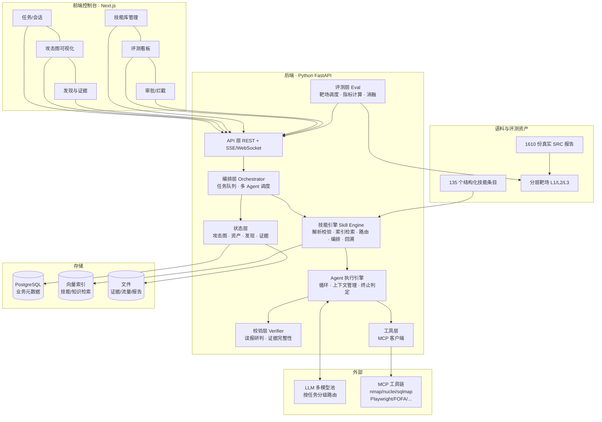

# 本科毕业设计（论文）开题报告

| 项目 | 内容 |
|---|---|
| **课题名称** | Hiive：技能驱动的 AI 渗透测试平台设计与实现 |
| **英文名称** | Hiive: Design and Implementation of a Skill-Driven AI Penetration Testing Platform |
| **学生姓名** | HiiragiHaru |
| **学号** | ＿＿＿＿＿＿＿＿ |
| **专业 / 班级** | ＿＿＿＿＿＿＿＿ |
| **指导教师** | ＿＿＿＿＿＿＿＿ |
| **开题日期** | ＿＿＿＿年＿＿月＿＿日 |
| **课题来源** | 自选课题（结合真实安全研究实践） |

---

## 一、选题背景与意义

### 1.1 背景

大语言模型（LLM）在代码理解、工具调用与长程规划上的能力跃升，使"由 AI 自主完成渗透测试"从设想走向工程实践。2024 年以来，一批自主渗透测试系统相继开源或商业化：ARTEX 在百度"agent+"攻防挑战赛中夺冠，PentAGI、Strix、CAI 等项目在 GitHub 上获得数千至上万关注，商业公司 XBOW 更是在 HackerOne 排行榜上取得领先名次。这一方向已成为网络安全与人工智能交叉领域最活跃的前沿之一。

然而，当前系统普遍存在一个根本性的**能力封装问题**：渗透知识的载体仍然是"通用提示词 + 模型自身记忆"。

具体表现为三个层面的缺失：

**（1）知识层面的缺失——渗透方法论不可复用、不可审计。**
真实渗透测试的有效性高度依赖经验性方法论，例如"优先测试未授权访问，再做水平越权，注意请求差异面（差分面）而非无差别喷洒探针"、"同一个接口只留 2～3 个代表性样本，避免同构重复"、"打开即是登录页时，应转向该主机的业务 API 而非纠缠登录表单"。这类知识目前只能写进系统提示词或对话上下文，无法版本化、无法组合、无法按目标裁剪，更无法回答"某条方法论到底带来多少收益"。系统提示词越长，模型注意力越分散，反而降低效果。

**（2）过程层面的缺失——Agent 行为不可控、不可验证。**
解除了提示词约束的 Agent 具有极大的行动自由度，实践中反复出现三类失效模式：
- **空转**：在同一资产面上反复扫描，用"测绘"行为冒充"挖掘"进度；
- **误报**：将 CORS 配置、信息泄露等低价值或无价值现象上报为漏洞，稀释报告可信度；
- **越界**：突破授权范围，对未授权资产发起请求，构成法律风险。

这些问题的根源在于：Agent 的决策空间是"任意工具调用的组合"，缺乏一个能把行为收敛到**受约束、可解释的状态空间**的中间层。

**（3）度量层面的缺失——能力提升不可量化。**
现有工作极少给出可比较的能力度量。当向系统新增一项能力（例如"增加 GraphQL 接口侦察"）后，无法回答：漏洞发现率提升了多少？误报率是否上升？成本增加几何？缺乏度量意味着缺乏科学迭代的依据，系统的演进只能依赖主观感受。

### 1.2 意义

**理论意义。** 本课题试图回答一个具有一般性的问题：**如何将领域专家知识形式化为可被 AI Agent 组合、验证与度量的计算单元？** 渗透测试是一个理想的试验场——它的知识边界清晰、成功判据客观（漏洞是否存在可验证）、失败代价可观测（误报、越界）。本课题提出的"可验证技能包"规范与"技能驱动的状态空间收敛"方法，可迁移到漏洞挖掘、代码审计、应急响应等其他安全任务，乃至更广泛的"专家知识 + Agent"场景。

**实践意义。** 本课题产出的是一个可运行、可演示的完整平台，而非概念原型。它将沉淀形式化的渗透技能库、可回放的评测集与量化指标，具备直接的使用价值。对于教学场景，平台可作为"可解释的自动化渗透"示范系统——每一步决策都能追溯到具体技能条目，相较于黑箱式 Agent 更利于教学与审计。

**个人研究基础。** 本课题并非从零起步。笔者在长期的白帽安全研究实践中已积累可观的领域语料：**135 个结构化技能条目**（覆盖 Web/API 渗透、域渗透、云原生安全、AI 安全等 16 个领域，其中含 240+ 子技能的结构化知识库、88 个 payload 文件、668 个 CVE 条目、34MB 字典库）、**1610 份真实 SRC 漏洞报告**，以及一套已在实践中验证的自建 Agent 身份包（`rules` 11 项 + 知识库 + MCP 工具链配置）。这构成了本课题区别于同类工作的**独有语料壁垒**，尤其是 1610 份真实报告，为构建贴近实战的评测集提供了他人难以复制的素材。

---

## 二、国内外研究现状与发展趋势

### 2.1 自主渗透测试系统的三条技术路线

按"知识与能力的承载方式"，现有工作可归为三条路线。

**路线一：端到端 Agent 循环（Prompt-centric）。**
以 PentestGPT（香港科技大学，USENIX Security 2024）为代表，将渗透过程建模为"推理—生成—解析"的迭代循环，用 LLM 维持任务状态并生成下一步命令，人在环路中执行。后续工作在自动化程度上做了大量推进：PentAGI 采用 Go 编写编排后端，引入任务分解、长期记忆与容器化工具执行环境；Strix 强调"自主黑客"式的多轮探索与漏洞验证；ARTEX 则构建了完整的工程化系统——Go 后端 + Next.js 前端，以 PostgreSQL 存储任务、会话、资产、发现与流量，并实现了探索链路图、资产覆盖图、流量录制、人在环路审批等完整功能。

**该路线的问题**：能力几乎完全由提示词与模型能力决定。ARTEX 虽已引入 `skills/` 目录（`SKILL.md` + `reference.md` + `scripts/`，即 Anthropic Agent Skills 的渐进披露范式），但其技能主要用于**注入领域提示词**，技能本身不是可度量的计算单元——没有前置/后置状态声明、没有验证判据、没有贡献度度量。

**路线二：静态/半静态代码审计（Code-centric）。**
以 Vulnhuntr 为代表，用 LLM 对代码做数据流分析，从入口点追踪到危险汇聚点（Source→Sink）以发现 RCE 等漏洞。此类方法精度较高、误报可控，但**只能覆盖白盒场景**，且依赖源码可得性，无法处理真实 SRC 场景中占绝对多数的黑盒资产。

**路线三：基准与评测驱动（Benchmark-centric）。**
AutoPenBench、Cybench、NYU CTF Bench、CyberMetric 等工作尝试建立评测标准。它们的主要贡献是提供了可比较的口径，但存在共同局限：**靶场以单点漏洞和 CTF 题为主**，与真实业务的差距较大——真实场景中漏洞往往藏在多步业务逻辑链里，且资产面巨大、噪声极多。这导致基准上的高分难以转化为真实场景中的有效性。

### 2.2 关键支撑技术的发展

**工具标准化（MCP）。** Anthropic 于 2024 年提出的 Model Context Protocol 已成为 LLM 与外部工具对接的事实标准。安全领域已出现大量 MCP Server（nmap、nuclei、sqlmap、Playwright 浏览器、FOFA 测绘等），这使平台无需自研每个工具的封装，可将精力集中在**决策层**。本课题的参考项目 ARTEX 与笔者的既有身份包均已采用 MCP 接入工具链。

**Agent 记忆与上下文工程。** 长任务中上下文爆炸是共性问题，主流做法是分层加载（元数据常驻 + 正文按需）、对话压缩（summarization compaction）、外部状态存储（将过程性信息落盘而非留在上下文）。ARTEX 实现了 compaction、blackboard（黑板）、coldgraph 等机制。这正是技能采用"渐进披露"设计的原因，也说明**将知识外置为可检索的资产是被验证有效的方向**。

**攻击图与状态建模。** 传统渗透测试领域已有成熟的攻击图（Attack Graph）理论，用于表示资产、漏洞与利用路径的因果关系。将 Agent 的决策建立在攻击图状态之上，是一个自然但尚少被系统实现的思路。

### 2.3 现状小结与研究空白

综合来看，现有工作的能力上限由"模型 + 提示词"决定，而领域知识始终以**非结构化文本**的形式存在，导致知识无法组合、行为无法约束、效果无法度量。

由此得出本课题要填补的空白：

> **如何将渗透领域知识形式化为一种可组合、可验证、可度量的计算单元，并以之为核心重构 AI 渗透测试系统的架构？**

这一空白正是"AI penetration **skill** platform"这一定位的由来——不是再做一个 Agent 循环，而是以**技能**为一等公民重新组织整个系统。

---

## 三、研究内容、目标与拟解决的关键问题

### 3.1 研究目标

设计并实现 Hiive —— 一个技能驱动的 AI 渗透测试平台。核心目标是使渗透能力从"提示词中的隐式知识"转变为"技能库中的显式计算单元"，并建立可量化的能力评测闭环。

具体目标：

1. 提出**可验证渗透技能包规范**，给出形式化定义与校验规则；
2. 实现**技能引擎**：解析、校验、索引、路由、编排、回溯；
3. 实现**技能驱动的渗透 Agent 执行引擎**：以攻击图状态为决策依据，多 Agent 分工，强制证据链与作用域约束；
4. 构建**分层评测集与度量方法**，完成技能贡献度的消融实验；
5. 实现**可视化控制台**，支持任务、资产图、会话、发现、技能库、评测与审批。

### 3.2 研究内容

#### 研究内容一：可验证渗透技能包的形式化与技能引擎

**（1）技能包规范设计。**
在现有 `SKILL.md`（YAML frontmatter + Markdown 正文 + 渐进披露参考文件 + 可执行脚本）基础上，扩展出**机器可读的能力声明**：

- **适用条件（precondition）**：描述技能何时适用，以状态谓词表达。例如"存在已认证会话 ∧ 存在返回列表的接口 ∧ 该接口存在对象标识参数"；
- **后置效应（postcondition）**：技能执行后攻击图状态的预期变化，例如"新增端点资产"、"新增发现候选"；
- **验证判据（verification）**：**本课题的核心设计**——技能自带"如何判定成功"的可执行判据，例如"发送两个不同对象 ID 的请求，若均返回 200 且数据归属不同主体，则判定存在水平越权"；
- **风险等级与副作用（risk / side_effect）**：标注是否可能造成数据修改、服务中断，供审批与节流策略使用；
- **依赖与提供（requires / provides）**：构成技能间的有向依赖图，支持自动编排与冲突检测；
- **自带评测用例（eval_case）**：技能附带的靶场测试用例，用于评测闭环自动验证技能有效性。

这套扩展使技能从"提示词素材"变为"带契约的状态转移算子"，是本课题全部后续工作的基础。

**（2）技能引擎实现。**
- **解析与校验**：schema 校验、依赖闭环检查、前置/后置谓词可满足性检查；
- **索引与检索**：技能描述的向量化索引 + 关键词/领域标签检索，支持"根据当前渗透状态找候选技能"；
- **路由**：结合当前攻击图状态、已执行技能历史与失败记录，对候选技能打分排序，输出 top-k；
- **编排**：依据 requires/provides 依赖图生成执行计划，检测循环依赖与状态冲突；
- **回溯**：记录技能的实际执行结果（成功/失败/无效），回填至技能统计，用于技能质量评估与路由权重调整。

**（3）分层加载与上下文控制**：元数据（name/description/前置后置）常驻上下文，技能正文按需加载，脚本与参考资料仅在执行时经工具调用读取，从架构上抑制上下文膨胀。

#### 研究内容二：技能驱动的渗透 Agent 执行引擎

**（1）攻击图状态表示。**
将渗透过程的状态显式建模为攻击图：节点包括资产（域名/IP/主机）、服务（端口/中间件）、端点（API 路径/参数）、凭证（会话/密钥）、发现（漏洞候选/确认漏洞）；边表示可达关系与利用依赖。技能的作用即是在该图上消费与生产状态。**这一设计把 Agent 的决策空间从"任意工具调用"收敛为"在图上选择技能"**，从根本上抑制空转与越界——不在图上的资产不可能被访问。

**（2）Agent 循环与多 Agent 分工。**
主循环为：观测当前状态 → 技能路由 → 生成执行计划 → 经工具层调用工具（MCP）→ 证据落盘 → 依验证判据判定 → 更新攻击图 → 终止判定。多个角色分工协作：

| 角色 | 职责 |
|---|---|
| Orchestrator | 全局规划，选择技能，维护攻击图与任务队列 |
| Executor | 执行具体技能的操作序列，调用工具，采集原始证据 |
| Verifier | **误报抑制的关键**：独立复核 Executor 的发现，检查验证判据是否真正满足、证据链是否完整、是否可复现 |
| Reporter | 汇总为结构化漏洞报告 |

Verifier 的引入直接针对现有系统的误报痛点：**只有通过独立验证的候选才能升级为"发现"**，且必须附带可复现证据（原始 HTTP 请求/响应、时间戳、复现步骤）。

**（3）约束与安全机制。**
- **作用域强制**：所有出站请求经统一出口校验，目标必须落在授权资产清单内，越界直接拒绝并告警；
- **风险审批**：高风险技能（可导致数据修改、服务中断）默认挂起，需人在环路批准；
- **请求节流**：按目标维度限速，避免对生产系统造成压力；
- **证据链强制**：无证据不产生发现，保证报告可信。

#### 研究内容三：能力评测闭环

**（1）分层评测集构建。**

| 层级 | 内容 | 目的 |
|---|---|---|
| L1 单点漏洞 | 公开靶场（DVWA、OWASP Juice Shop、Vulhub 容器化环境） | 与现有基准对齐，便于横向比较 |
| L2 多步利用链 | 自建带真实业务逻辑漏洞的 Web 应用（越权链、认证绕过链、注入到 RCE） | 弥补公开靶场"单点、理想化"的不足 |
| **L3 真实场景回放** | 基于 1610 份真实 SRC 漏洞报告，脱敏后重构为"给定资产范围 → 能否发现已知漏洞"的可回放场景 | **本课题的独有评测维度**，检验真实场景有效性 |

**（2）度量指标。**
- **有效性**：漏洞发现率（Recall）、精确率（Precision）、误报率（FPR）；
- **过程质量**：杀伤链阶段覆盖率（对照 MITRE ATT&CK / Kill Chain 阶段）、平均步数、无效动作占比（衡量空转）；
- **成本**：token 消耗、墙钟时间；
- **技能维度**：技能命中率、**技能贡献度**。

**（3）消融实验（核心实验）。**
在固定模型与靶场的前提下，通过启用/禁用特定技能组、以及对比"技能驱动架构 vs 传统纯提示词 Agent"，量化：
- 技能架构相对纯提示词基线在发现率与误报率上的差异；
- 单个技能或技能组对指标的边际贡献；
- 上下文占用与 token 成本的变化。

这组实验是"技能化设计有效"这一论点的直接证据，构成本课题论文的实验章节核心。

#### 研究内容四：可视化控制台

基于 Next.js 实现控制台，包含：任务管理与实时执行过程、**攻击图可视化（力导向布局，已测节点高亮）**、会话与工具调用追踪、发现列表与证据查看、技能库管理（浏览/检索/统计/贡献度）、评测看板（指标对比与消融结果）、审批与拦截界面。

### 3.3 拟解决的关键问题

| # | 关键问题 | 拟采用的解决思路 |
|---|---|---|
| 1 | **技能的可验证性**——如何让技能自带成功判据且判据可执行、可复现？ | 设计受限的验证谓词 DSL（基于攻击图状态与 HTTP 响应匹配），并限定为可在沙箱中自动执行的操作子集 |
| 2 | **技能路由的准确性**——如何从技能库中选出当前状态真正适用的技能，而非全量注入？ | 前置条件谓词匹配 + 向量检索混合排序；以执行回溯数据在线调整权重 |
| 3 | **状态空间爆炸**——攻击图规模增长后如何维持决策效率？ | 分层抽象（资产簇 → 主机 → 端点）+ 状态摘要 + 仅对活跃子图做技能路由 |
| 4 | **误报抑制**——如何让"发现"具备可信度？ | 独立 Verifier Agent + 强制验证判据 + 证据链完整性校验，三级把关 |
| 5 | **评测集构建**——如何从 1610 份非结构化真实报告中提取可回放场景？ | 报告结构化解析（漏洞类型、资产特征、复现步骤、请求响应）→ 脱敏 → 目标环境重建或等价靶场生成 |
| 6 | **合法合规边界**——如何从架构上保证不越界？ | 授权资产清单 + 统一请求出口强校验 + 高风险操作审批，边界不依赖提示词自觉 |

---

## 四、研究方法与技术路线

### 4.1 研究方法

1. **文献研究法**：系统梳理自主渗透测试、Agent 架构、Agent Skills 范式与评测基准的现有工作，明确技术空白（第二章）。
2. **形式化建模法**：将渗透技能与攻击图状态形式化定义，给出技能的前置/后置/验证三元契约。
3. **原型实现法（Design Science）**：以可运行系统为研究载体，通过构建真实平台来验证设计假设。
4. **实验对比法**：构建分层评测集，采用对照实验与消融实验量化技能架构的有效性。
5. **案例研究法**：选取真实 SRC 场景构造回放案例，检验系统在真实条件下的表现与失效模式。

### 4.2 技术路线

### 4.3 关键技术选型

| 层 | 选型 | 理由 |
|---|---|---|
| 后端 | Python 3.12 + FastAPI | AI 生态最完善（各家 LLM SDK、向量库、评测工具），异步支持好，适合 Agent 长任务 |
| 前端 | Next.js + React + TypeScript | 与参考项目 ARTEX 技术栈一致，便于借鉴交互设计；生态成熟 |
| 数据库 | PostgreSQL | 结构化业务数据 + JSONB 灵活存储攻击图状态 |
| 向量检索 | 轻量本地方案（如 sqlite-vec / pgvector） | 部署简单，避免引入重型向量数据库 |
| Agent 编排 | 自研循环（不依赖 LangGraph 等重型框架） | **技能路由与攻击图状态是本课题的核心创新，需完全掌控决策链路**；框架会遮蔽关键控制点 |
| 工具接入 | MCP（Model Context Protocol） | 复用成熟 MCP Server，聚焦决策层而非工具封装 |
| LLM | 多模型池，按任务分级路由 | 复杂规划用强模型，机械操作与验证用低成本模型，平衡效果与开销 |
| 容器与靶场 | 各尽所用（本地靶场 + 容器化 Vulhub） | 隔离风险，便于评测复现 |

### 4.4 可行性分析

- **语料可行**：已有 135 个技能条目与 1610 份真实报告，无需从零积累领域知识；
- **技术可行**：参考项目 ARTEX（Go + Next.js）源码已完整获取，其技能机制、数据模型、前端交互均可借鉴；笔者已有自建 Agent 身份包的实践经验；
- **工具可行**：本机已具备 Python 3.14、Node.js、Go 工具链，以及 FOFA 测绘、Playwright 浏览器、Burp、sqlmap、dirsearch、ffuf 等安全工具与 MCP 封装；
- **风险可控**：全部测试在自有靶场与授权范围内进行，不涉及未授权目标。

### 4.5 难点与应对

| 难点 | 应对 |
|---|---|
| 验证谓词 DSL 的表达力与可执行性难两全 | 从最小可用子集起步（HTTP 响应断言 + 状态断言），以真实技能反推需要的谓词类型，迭代扩展 |
| 多 Agent 协作的稳定性（死循环、互相等待） | 引入步数上限、状态无变化检测、终止原因显式记录（参考 ARTEX 的 terminalreason 设计） |
| L3 真实报告转可回放场景工作量大 | 先做小规模（20～30 个场景）验证方法有效性，再按需扩展；建立半自动解析流水线 |
| 评测结果受 LLM 随机性影响 | 多次重复取统计量；固定温度与种子；分层报告方差 |

---

## 五、创新点

**创新点一：提出"可验证渗透技能包"规范，使渗透知识成为带契约的计算单元。**
现有系统（含 ARTEX）中的技能本质是提示词素材，只描述"怎么做"。本课题将技能扩展为 **前置条件 / 后置效应 / 验证判据 / 风险副作用 / 依赖提供 / 自带评测用例** 的六元契约，使技能具备三项此前不具备的性质：**可组合**（依赖图可自动编排）、**可验证**（自带成功判据，可自动判定）、**可度量**（可通过消融实验计算边际贡献）。这是把领域知识从"文本"提升为"程序化资产"的关键一步。

**创新点二：提出技能驱动的攻击图状态机，以状态收敛替代行动自由。**
将 Agent 的决策空间由"任意工具调用的组合"收敛为"在攻击图上选择技能"，技能被建模为攻击图上的**状态转移算子**。该设计使空转（不在图上的动作不发生）、越界（不在授权清单上的资产不可达）、不可解释（每次决策可追溯到具体技能条目）三个问题在架构层面得到抑制，而非依赖提示词的软约束。

**创新点三：构建基于真实漏洞报告的评测集与技能贡献度度量方法。**
针对公开靶场"单点、理想化、无业务逻辑"的局限，本课题利用 1610 份真实 SRC 报告构建 L3 真实场景回放评测集，并在此基础上提出**技能贡献度**指标与消融协议，使"某项能力带来多少收益"成为可计算的问题，为 AI 渗透能力的科学迭代提供度量工具。

> 三者关系：**创新点一**定义基本单元，**创新点二**定义单元如何被组织与执行，**创新点三**定义如何证明这一设计的有效性。三者构成"规范—架构—度量"的完整闭环，这也是本课题选择"引擎 + 评测闭环"组合而非单一方向的原因。

---

## 六、进度安排

| 阶段 | 时间 | 主要任务 | 阶段成果 |
|---|---|---|---|
| 一、开题与调研 | 第 1～3 周 | 文献调研、同类系统分析（ARTEX/PentAGI/Strix/CAI 等）、技能语料盘点、需求分析 | 开题报告、技能资产清单、需求规格说明 |
| 二、总体设计 | 第 4～6 周 | 技能包规范形式化定义、攻击图状态模型设计、系统架构与数据库设计 | 概要设计说明书、详细设计文档、原型图 |
| 三、技能引擎实现 | 第 7～10 周 | 技能解析/校验/索引/路由/编排/回溯；技能库导入与规范化 | 技能引擎模块 + 单元测试 + 技能库 |
| 四、Agent 引擎实现 | 第 11～14 周 | Agent 主循环、多 Agent 分工、工具层 MCP 接入、作用域与审批机制、证据链 | 可运行的端到端最小闭环（单目标 → 发现 → 报告） |
| 五、控制台实现 | 第 15～17 周 | Next.js 控制台全部页面，重点攻击图可视化与技能库管理 | 完整可视化系统，可演示 |
| 六、评测体系 | 第 18～20 周 | L1/L2/L3 评测集构建、指标实现、消融实验 | 评测集、实验数据与图表 |
| 七、论文撰写与答辩 | 第 21～24 周 | 系统完善、实验补充、论文撰写与修改、答辩准备 | 毕业论文、答辩材料、演示视频 |

> 说明：进度按"先核心引擎、后可视化、最后评测与论文"安排，保证任一阶段中断时均有可交付产物。**第五阶段控制台可依据实际情况前移**（若中期检查需要演示物）。

---

## 七、预期成果与工作量

### 7.1 预期成果

1. **可运行系统一套**：Hiive 平台完整源码（后端 + 前端 + 技能库），支持从任务创建到报告生成的端到端流程；
2. **技能包规范与技能库**：规范的正式定义文档 + 规范化后的技能库（可开源部分）；
3. **评测集与实验数据**：分层评测集（L1/L2/L3，L3 含脱敏真实场景）、完整实验数据与消融结果；
4. **毕业设计论文一篇**；
5. **技术文档**：概要设计、详细设计、使用手册、演示视频。

### 7.2 工作量预估

| 模块 | 预估代码量 | 说明 |
|---|---|---|
| 技能引擎 | 约 2500 行 | 解析/校验/索引/路由/编排/回溯 |
| Agent 执行引擎 | 约 3000 行 | 循环、多 Agent、上下文管理、状态机 |
| 工具层与 MCP 接入 | 约 1500 行 | MCP 客户端、工具注册、作用域出口 |
| 状态层与存储 | 约 1500 行 | 攻击图、数据模型、迁移 |
| 评测层 | 约 1500 行 | 靶场调度、指标、消融 |
| API 层 | 约 1200 行 | REST + SSE/WebSocket |
| 前端 | 约 6000 行 | 8 个主要页面 + 攻击图可视化 |
| 技能库整理与编写 | 约 30～50 个技能 | 从 135 个条目筛选、规范化、补充验证判据与评测用例 |
| **合计** | **约 17000 行代码 + 技能库** | 符合本科毕业设计工作量要求 |

---

## 八、参考文献

### 学术论文

[1] Deng G, Liu Y, Mayoral-Vilches V, et al. PentestGPT: An LLM-empowered Automatic Penetration Testing Tool[J]. arXiv preprint arXiv:2308.06782, 2023. （后发表于 USENIX Security 2024）

[2] Happe A, Cito J. Getting pwn'd by AI: Penetration Testing with Large Language Models[C]//Proceedings of the 31st ACM Joint European Software Engineering Conference and Symposium on the Foundations of Software Engineering (ESEC/FSE). 2023.

[3] Fang R, Bindu R, Gupta A, et al. LLM Agents can Autonomously Hack Websites[J]. arXiv preprint arXiv:2402.06664, 2024.

[4] Zhang Y, et al. AutoPenBench: Benchmarking Generative Agents for Penetration Testing[J]. arXiv preprint, 2024.

[5] Zhang A K, Perry N, Ramesh R, et al. Cybench: A Framework for Evaluating Cybersecurity Capabilities and Risks of Language Models[J]. arXiv preprint arXiv:2408.08926, 2024.

[6] Shao M, et al. NYU CTF Bench: A Scalable Open-Source Benchmark Dataset for Evaluating LLMs in Offensive Security[J]. arXiv preprint, 2024.

[7] Yao S, Zhao J, Yu D, et al. ReAct: Synergizing Reasoning and Acting in Language Models[C]//International Conference on Learning Representations (ICLR). 2023.

[8] Shinn N, Cassano F, Gopinath A, et al. Reflexion: Language Agents with Verbal Reinforcement Learning[C]//Advances in Neural Information Processing Systems (NeurIPS). 2023.

[9] Wang L, Ma C, Feng X, et al. A Survey on Large Language Model based Autonomous Agents[J]. Frontiers of Computer Science, 2024.

### 开源系统与工程资料

[10] mhtsec. ARTEX: AI 自主渗透测试系统（Go 后端 + Next.js 前端）[EB/OL]. https://github.com/mhtsec/ARTEX

[11] vxcontrol. PentAGI: Autonomous AI Red Team Tool[EB/OL]. https://github.com/vxcontrol/pentagi

[12] Alias Robotics. CAI (Cybersecurity AI): An Open Framework for AI in Cybersecurity[EB/OL]. https://github.com/aliasrobotics/cai

[13] Strix. Autonomous AI Hackers[EB/OL]. https://github.com/usestrix/strix

[14] Protect AI. Vulnhuntr: LLM-powered Static Analysis for Zero-day Discovery[EB/OL]. https://github.com/protectai/vulnhuntr

[15] Anthropic. Model Context Protocol Specification[EB/OL]. https://modelcontextprotocol.io

[16] Anthropic. Agent Skills: Progressive Disclosure for Agent Knowledge[EB/OL]. https://docs.anthropic.com

[17] Autumn-27. ScopeSentry: 分布式资产测绘系统[EB/OL]. https://github.com/Autumn-27/ScopeSentry

[18] RuoJi6. AegisHook[EB/OL]. https://github.com/RuoJi6/AegisHook

### 标准与规范

[19] MITRE. ATT&CK® Framework[EB/OL]. https://attack.mitre.org

[20] OWASP Foundation. OWASP Top 10:2021 & OWASP Web Security Testing Guide[EB/OL]. https://owasp.org

[21] OWASP Foundation. OWASP Top 10 for Large Language Model Applications[EB/OL]. https://genai.owasp.org

[22] 全国信息安全标准化技术委员会. GB/T 38645-2020 信息安全技术 网络安全事件应急演练指南[S]. 北京: 中国标准出版社, 2020.

---

## 附录 A：已有研究基础量化清单

> 数据由 `scripts/inventory_skills.py` 扫描本机语料自动生成，可复现。

| 语料来源 | 技能条目 | 磁盘文件数 | 体积 |
|---|---:|---:|---:|
| 结构化技能库（含 16 个安全域） | 133 | 4469 | 126.7 MB |
| 自建 Agent 身份包（rules + 知识库 + MCP 配置） | 1（含 11 项 rules） | 102 | 1.5 MB |
| 真实 SRC 漏洞报告语料 | — | 1610 | — |
| **合计技能条目** | **135** | — | — |

技能库覆盖领域包括：Web/API 渗透、注入类漏洞、认证与授权缺陷、客户端安全、云原生与容器安全、Active Directory 域渗透、免杀与 C2、CTF、取证与应急响应、威胁情报、移动端安全、AI/LLM 安全、硬件固件等。

## 附录 B：本机可用工具链

| 类别 | 工具 |
|---|---|
| 运行时 | Python 3.14、Node.js、Go、Java |
| 安全工具 | Burp Suite Pro、sqlmap、dirsearch、ffuf、EHole、EyeWitness、FinalRecon、TscanPlus、Cscan、enscan、ZAP、Metasploit |
| 测绘与浏览器 | FOFA（MCP 封装）、Playwright（MCP 封装） |
| 语料 | seclists、1610 份 SRC 报告、结构化技能库 |
