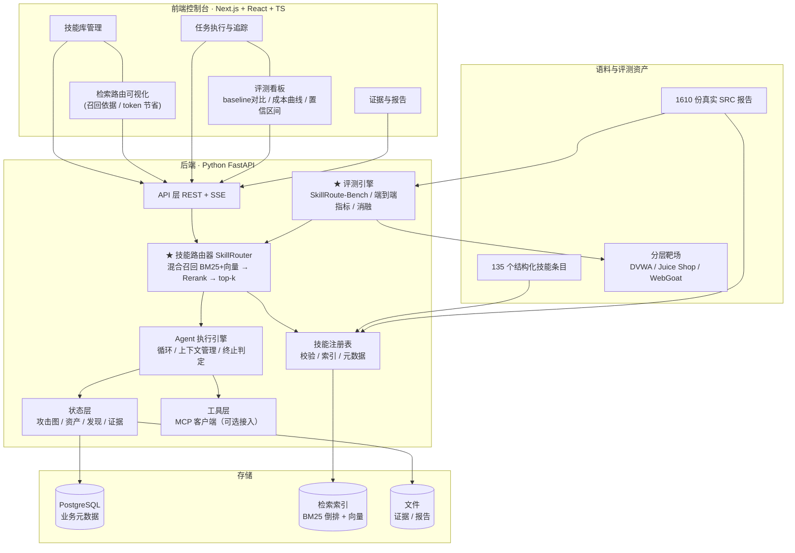

# 本科毕业设计（论文）开题报告

| 项目 | 内容 |
|---|---|
| **课题名称** | Hiive：技能驱动的 AI 渗透测试平台设计与实现 |
| **副标题** | ——面向技能检索路由与有效性度量 |
| **英文名称** | Hiive: Design and Implementation of a Skill-Driven AI Penetration Testing Platform with Skill Retrieval Routing and Effectiveness Measurement |
| **学生姓名** | HiiragiHaru |
| **学号** | ＿＿＿＿＿＿＿＿ |
| **专业 / 班级** | ＿＿＿＿＿＿＿＿ |
| **指导教师** | ＿＿＿＿＿＿＿＿ |
| **开题日期** | ＿＿＿＿年＿＿月＿＿日 |
| **课题来源** | 自选课题（结合真实安全研究实践） |

> **数据说明**：本报告涉及的开源项目元数据（star / fork / 许可证 / 创建时间）为 **2026-10-14 快照**，其中 `strix`（68,428）、`mhtsec/ARTEX`（3,922）、`vxcontrol/pentagi`（28,339）三项由笔者独立复核，与调研数据一致。AI 渗透赛道 star 增速极快（`strix` 三个月内自约 41k 增至 68k），**论文定稿前须重新核实并标注日期**。

---

## 一、选题背景与意义

### 1.1 背景：一个已经饱和的赛道，与一个尚未填平的缺口

"AI 自主渗透测试"在 2025—2026 年间已从论文概念演变为工程红海。据 2026-10-14 快照，仅开源侧就有 **46 个以上自主渗透 Agent 项目**（`strix` 68.4k star、`pentagi` 28.3k、`PentestGPT` 15.9k、`CyberStrikeAI` 7.8k），商业侧则出现 XBOW（C 轮 1.2 亿美元、估值超 10 亿美元）等独角兽；国内微步在线于 2026-09 直接收购了开源项目 CyberStrikeAI，绿盟、奇安信、阿里云、京东云、安恒、斗象、悬镜等厂商均已上线智能渗透产品。

这一现状对本课题提出了一个必须正面回答的问题：

> **如果"AI 渗透测试平台"本身已经被充分实现，那么本课题的价值何在？**

答案是：**通用平台层已经成熟，但其内部一个关键子问题至今无解——技能（Skill）的组织与调度。**

现有主流系统均把领域知识以 `SKILL.md` 形式封装（Anthropic Agent Skills 规范，已成为事实标准），但调度方式一律是**元数据全量注入**：把技能库中每个技能的 `name` + `description` 全部塞进系统提示。这种方式存在一个可量化的硬上限：

| 技能库规模 | 全量注入的上下文开销（按约 100 token/技能估算） |
|---|---:|
| 50 个技能 | ≈ 5k token |
| 200 个技能 | ≈ 20k token |
| 500 个技能 | ≈ 50k token |
| 800 个技能 | ≈ **80k token** |

而现实中的技能库正在迅速膨胀：`zhaoxuya520/reverse-skill` 约 4.1 万 star、`Anthropic-Cybersecurity-Skills` 声称收录 817 个技能、`CyberStrikeAI` 声称 7300+ 技能（后二者数量未经核实）。笔者的本机技能语料亦已达 **135 个结构化技能条目 / 126.7 MB**。

**结论是清晰的**：技能库越大，全量注入越不可行；而"该用哪个技能"这一决策问题的解法，在现有规范（agentskills.io 只定义格式，不定义检索）中**完全缺失**。这是本课题的立足点。

### 1.2 研究空白的确证

本课题不自行臆造"研究空白"，而是选取**有权威一手来源明确承认尚未解决**、且**经本文逐条核实**的问题。

> **重要说明（写作纪律）**：AI 渗透领域 2026 年进展极快，"某某是空白"这类断言极易被评委用一篇新论文推翻。本节**只保留经核实仍成立的空白**，并在 §2.4 主动列出与本课题相邻、但**已被他人解决**的方向——"承认已有工作 + 精确定位剩余空白"的写法比声称"完全空白"更经得起追问。

| 编号 | 空白点 | 证据 | 核实状态 |
|---|---|---|---|
| **G3** | **技能检索与路由算法**——技能库规模增大后元数据即吃掉上下文预算；`description` 的撰写质量直接决定路由正确率 | agentskills.io 官方规范**只定义技能格式，不定义检索方案**；未检索到任何公开的技能路由质量评测 | ✅ 已核实 |
| **G4** | **"技能有效性 / 技能质量"度量基准** | 未检索到任何针对"技能"这一单位的质量基准（既有基准的评测单位是**任务**或**Agent**，不是技能） | ✅ 已核实 |

**G3 与 G4 是本课题的全部立足点。** 需要特别澄清二者与相邻工作的边界：

- G3/G4 的评测对象是**技能调度层**（"该给 Agent 看哪些技能"），
  而既有基准评测的是**执行层**（"Agent 最终有没有打进去"）——二者正交。
- 因此本课题**不声称**"误报率评测是空白"或"越界检测是空白"：
  这两个方向上 2026 年已有扎实工作（见 §2.4），本课题将直接引用而非重复。
- 相应地，本课题的评测**不以"端到端打靶成功率"为主要指标**，而以
  **路由质量（Recall@k / MRR / 误路由率）+ 上下文成本**为主——
  这类评测完全离线、零 API 成本、可复现，且不与他人工作重叠。

### 1.3 选题意义

**理论意义。** 本课题研究的是"**当领域知识条目数量远超上下文预算时，Agent 如何按需调度知识**"这一具有一般性的问题。渗透测试是研究该问题的理想载体——技能条目天然分层（侦察/利用/后渗透）、任务目标明确、成功判据客观。所提出的两阶段检索路由架构与路由质量基准，可迁移到代码审计、应急响应、合规检查等一切"专家知识 + Agent"的场景。

**实践意义。** 技能库的上下文经济学（context economics）当前无人系统研究，而它直接决定了 AI 渗透系统能否 scale 到千级技能库。本课题将给出**首份技能路由质量基准**，以及"技能描述应如何撰写才能被可靠路由"的实证结论——这对 agentskills.io 规范本身是有价值的补充。

**研究基础优势。** 笔者已有 **135 个结构化技能条目**（覆盖 16 个安全域，含 240+ 子技能的知识库、88 个 payload 文件、668 个 CVE 条目、34MB 字典库）与 **1610 份真实 SRC 漏洞报告**。这为本课题提供了同类工作难以复制的语料基础：**技能库规模足以让"全量注入"真实地失效**，而 1610 份真实报告可作为端到端任务的真实任务描述来源。

### 1.4 技能范式自身的风险（必写局限，否则答辩必被追问）

本课题把"技能"作为核心抽象，因此**必须先承认该抽象自身的已知风险**：

> **Practice Makes Unsafe: Skill Misevolution in Self-Improving LLM Agents**
> （arXiv:2608.12851，2026-08，已核实 ✅）

该研究报告：在受测的 **21 种「Agent × 演化方式」组合中，全部**出现了把
**不安全流程固化进技能**的现象；其中 15 种会把危害带入新会话，
且演化在 17 种组合中**提升了恶意危害程度**。

**为什么这对本课题是致命的（如果不处理）？**
本课题的索引侧富化、元数据推断都属于**对技能库的自动加工**——
若加工过程缺乏约束，本身就可能成为"技能劣化"的一个通道。

**本课题的应对（将作为设计约束而非口头承诺）**：

1. **不自动修改技能正文**：本课题的一切加工（元数据推断、触发词富化）都产出
   **覆盖层**，原始 `SKILL.md` **字节不变**（已实现，见 `tests/test_metadata.py::
   test_overlay_does_not_modify_source_files`）。正文是技能语义的唯一真值来源，
   自动化流程不得改写它。
2. **保守填充**：只填补空字段，绝不覆盖语料作者已声明的值
   （已实现，`apply_overlay(only_missing=True)`）。
3. **高风险技能标记**：推断 `risk: high` 的技能默认需要人在环路审批（M6 实现）。
4. **技能库版本化与可回滚**：覆盖层是独立产物，可版本化、可复核、可回滚。

> **诚实声明**：本课题**不**声称解决了技能劣化问题。上述措施只是"不主动制造"
> 劣化通道，而**不构成对演化型劣化的防护**——那需要独立的研究。
> 这一点将明确写入论文的"局限与未来工作"。

### 1.5 学术与法律合规边界（前置声明）

1. **全部实验仅在自建靶场与授权环境内进行**，不针对任何公网真实目标——这既是学术红线，也是法律红线。
2. **不使用 ARTEX 源码**。`mhtsec/ARTEX` 采用 AGPL-3.0，**且附加了"禁止对任何线上系统测试（无论是否授权）"的限制条款**。本课题仅将其作为架构思想参考（clean-room），**不复用其任何代码**，以避免许可证传染与条款冲突。
3. 技能库中涉及第三方付费知识库（如 AboutSecurity）的部分**不纳入公开仓库**，仅保留可开源技能与自研技能。

---

## 二、国内外研究现状与发展趋势

### 2.1 自主渗透测试系统的三条技术路线

**路线一：端到端自主 Agent（主流）。**
以 `PentestGPT`（USENIX Security 2024）开其先河，将渗透建模为"推理—生成—解析"迭代循环。此后工程化程度迅速提高：`PentAGI` 以 Go 微服务架构实现 12 种以上专职 agent（`primary_agent / pentester / searcher / advisor / reflector / coder` 等），并给出以**字节预算**为单位的链式摘要（Chain Summarization，如 `SUMMARIZER_LAST_SEC_BYTES=51200`）与执行监控（同一工具重复 5 次即唤起 Adviser）；`strix` 采用 Graph of Agents；`Decepticon`、`CyberStrikeAI`、`ARTEX`、`Cairn` 各有侧重。

其中 **`ARTEX` 的"双图架构"**值得单独说明：它将状态分为**资产图**（全局共享的资产真值库，节点为 root_domain/subdomain/ip/service/app/endpoint）与**探索图**（每任务独立的过程图，节点为 goal/intent/fact/finding/hint，以 `spawns/derived_from/yields/proves` 连成血缘链），两图通过锚点表关联。其角色分工为 `goals → planner（唯一意图生成者，从不亲自执行）→ worker ×N（领一条意图、执行、写回即停）`。这一"确定性逻辑由程序负责、LLM 只提交原始信息"的设计原则具有参考价值。

**路线二：静态/半静态代码审计（白盒）。**
以 `Vulnhuntr` 为代表，用 LLM 对代码做 Source→Sink 数据流分析，已挖出多个真实 0day。精度较高，但**只覆盖白盒场景**，无法处理真实 SRC 中占绝对多数的黑盒资产。`GPTScan`（ICSE'24）在智能合约逻辑漏洞上采用了同类思路。

**路线三：基准与评测驱动。**
`AutoPenBench`、`Cybench`、`NYU CTF Bench`、`CVE-Bench`、`CyberGym`、`SEC-bench`、`XBOW Validation Benchmarks`（104 题）、`TSecBench`（腾讯云鼎实验室，63 题）等陆续建立。这些基准的**共同局限**在于：评测单位是**任务**（"这个目标打进去了吗"），靶场以**单点漏洞与 CTF 题**为主，与真实业务的差距较大。

需特别指出：**"只报解出率、不报精确率"这一批评在 2026 年已不再准确**——详见下节。

### 2.4 相邻方向的最新进展（本课题主动承认并引用，不重复）

本课题的核心空白是 G3/G4（技能调度层）。以下相邻方向**已有他人完成扎实工作**，本课题不声称其为空白，而是直接引用其结论、并在设计上与之正交：

| 方向 | 代表作 | 与本课题的关系 |
|---|---|---|
| **执行前授权门控** | `ScopeJudge: Cost-Aware Pre-Execution Gating for Offensive Security Agents`（arXiv:2607.07774） | 解决"该不该执行某个动作"；本课题解决"该不该把某个技能放进上下文"——**同属决策层但对象不同** |
| **越界边界保持** | `ScopeBench: Do Agents Preserve Engagement Boundaries Under Goal Pressure?`（arXiv:2609.30325，30 个"只有越界才能完成"的配对任务） | 评测 Agent 在目标压力下是否越界；本课题不涉及 |
| **漏洞验证与误报** | `ATOBench: Tracing How Autonomous Penetration-Testing Agents Verify Vulnerabilities When Target Evidence Lies`（arXiv:2608.12996） | 评测**验证环节**（目标证据说谎时的判定）；这正是本文 §1.2 曾误判为"空白"的 G6，**现已被填补** |
| **与专业人员的对比评测** | `Comparing AI Agents to Cybersecurity Professionals in Real-World Penetration Testing`（arXiv:2512.09882） | 提供人机对比基线；本课题在端到端实验中可直接引用其结论作为参照 |

**这一节的写作意义**：AI 渗透领域论文迭代极快，若在"相关工作"中声称某方向是空白，而被评委指出遗漏了上述 2026 年工作，将直接损害可信度。**主动承认 + 精确划界**是更稳妥的写法。

### 2.5 关键支撑技术：Agent Skills 与 MCP

**Agent Skills（agentskills.io 规范）** 已成为技能封装的事实标准：`SKILL.md`（YAML frontmatter 的 `name` + `description`，正文为方法论）+ 渐进披露的 `reference.md` + 可执行 `scripts/`。其核心设计正是为缓解上下文压力——**元数据常驻、正文按需加载**。

但该规范**只解决"技能如何被描述"，未解决"技能如何被选中"**。规范未规定检索算法、未定义路由质量指标、未涉及技能间冲突消解（两个技能给出相反指令时如何处理），亦未给出 `description` 的撰写质量判据。这正是空白 G3 的由来。

**MCP（Model Context Protocol）** 解决了"工具能否被调用"。但需指出两点：

- MCP 与 Skill **互补而非替代**：MCP 描述"工具是什么"（可执行），Skill 表达"该怎么做"（方法论）。对"AI penetration skill platform"这一题目，**Skill 层才是主战场**，MCP 层应直接复用成熟方案（如 `mcp-security-hub` 的 38 个容器化 server、`PortSwigger/mcp-server` 的 Burp 官方桥接）。
- MCP 自身存在**上下文代价**：工具定义（名称+描述+JSON Schema）是**常驻上下文**的，单个工具保守估计 150–500 token。挂载 3 个 server 即产生约 1–3 万 token 常驻开销。**MCP 层的"按需加载"同样没有标准方案**——这与 G3 是同一问题的两个侧面，可在本课题中一并处理。
- 需诚实记录一个**反面证据**：`oritera/Cairn` 在腾讯云黑客松智能渗透挑战赛中取得 54/54 全 AK（613 支队伍中唯一全 AK），而它明确宣称 *"Zero MCP tools, zero RAG, zero predefined agent roles"*，仅用 Fact / Intent / Hint 三个原语与黑板架构。**这说明 MCP 并非必要条件**，本课题将其作为可选工具接入层而非核心依赖。

### 2.6 现状小结

综合而言：

1. **通用平台层已高度成熟**（至少 46 个开源 Agent + 32 个商业产品），"再造一个平台"不构成创新；
2. **技能已成为知识封装的共识格式**，但技能库的**调度与度量**仍是空白（G3/G4）；
3. **上下文工程是该方向的核心竞争力**——`PentAGI` 用整节 README 与 6 个字节预算参数说明这一点，并直言典型 agent 工作流消耗约 64K token；
4. **验证、越界、误报等相邻方向在 2026 年已获扎实进展**（§2.4），本课题**不重复**这些工作，而是聚焦于它们的前置环节——**技能调度**。

因此本课题的定位是：

> **不再造平台，而是在"技能调度"这一真实空白上做深，并以一个自建平台作为验证与演示载体。**

---

## 三、研究内容、目标与拟解决的关键问题

### 3.1 研究目标

1. 建立**规范化的渗透技能库**：将多源技能语料统一为符合 agentskills.io 规范的 `SKILL.md`，并补充机器可读的路由元数据；
2. 提出并实现**两阶段技能检索路由架构**：以轻量检索器召回 top-k，仅注入 k 个技能完整正文，量化其相对全量注入的上下文成本与成功率变化；
3. 构建 **SkillRoute-Bench**：首个技能路由质量基准（含标注方法与 Recall@k / MRR / 误路由率指标）；
4. 建立**技能有效性度量方法**：端到端任务成功率、精确率/召回率、token 成本，并给出非确定性 Agent 实验的可复现性披露规范；
5. 实现**平台载体**：基于 FastAPI + Next.js 的可运行系统，支持技能库管理、检索路由可视化、任务执行与评测看板。

### 3.2 研究内容

#### 研究内容一：渗透技能库的规范化与路由元数据设计

- **统一转换**：将 135 个多源技能条目（不同来源的 frontmatter 方言不一，含 YAML 折叠块标量等）规范化为统一 `SKILL.md`，并建立校验器（必填字段、依赖闭包、正文规模上限）；
- **路由元数据设计**：这是本课题的第一处设计工作。在 agentskills.io 规范的 `name` + `description` 之外，补充**面向检索的机器可读字段**：适用阶段（侦察/利用/后渗透）、目标类型（Web/API/AD/云原生/移动端）、前置条件、所需工具、风险等级、典型触发语。这些字段直接决定检索召回质量；
- **语料二次利用**：从 1610 份真实 SRC 报告中提取"任务描述 → 实际使用的技能"配对，作为路由标注数据的来源（需脱敏）。

#### 研究内容二：两阶段技能检索路由架构（核心）

**架构**：`用户任务描述 + 当前渗透状态` → **阶段一：轻量检索器**（BM25 关键词 + 向量语义双路召回，融合排序）从全库召回 top-k → **阶段二：完整技能正文注入**（仅 k 个）→ Agent 执行。

**需研究并实验验证的关键设计选择**：

| 设计维度 | 待比较的方案 |
|---|---|
| 检索器 | BM25 / 向量（本地 embedding 模型）/ 二者混合 / 小模型分类器 |
| 召回粒度 | 技能级 / 领域级两级召回 |
| 路由输入 | 仅任务描述 / 任务描述 + 当前渗透状态（攻击图节点）/ 含历史执行反馈 |
| k 的取值 | 影响成功率与 token 成本的权衡曲线 |
| 元数据消融 | 逐个移除路由元数据字段，考察召回率下降幅度（**用于反向推导 `description` 写作规范**） |

**输出**：可配置的 `SkillRouter` 模块 + 上述各维度的对照实验数据。

#### 研究内容三：SkillRoute-Bench 技能路由质量基准

针对空白 G4（不存在任何技能质量基准），构建首个技能路由基准：

- **任务集**：从真实渗透任务描述（`"目标是一个 WordPress 站点，我要找管理员入口"` 类）构造 **200+ 条任务描述**，覆盖 16 个安全域；
- **真值标注**：由笔者依据专业技能与 1610 份真实报告，为每条任务标注"应当召回的技能集合"，并记录标注置信度；
- **指标**：Recall@k、MRR、误路由率（召回了不适用技能的比例）、token 成本；
- **Baseline**（**答辩必查项**）：全量注入、关键词匹配、纯向量检索、朴素 LLM 直接选择。

基准与标注数据将开源（脱敏后），使本课题成果可被复现与比较。

#### 研究内容四：技能有效性度量与实验方法学

- **端到端评测**：在公开靶场（DVWA / OWASP Juice Shop / WebGoat 的**版本与漏洞已知**的实例）上运行完整 Agent 流程；
- **指标**：任务成功率、漏洞精确率/召回率/F1（**作为辅助指标**；误报/验证方向已有 `ATOBench` 等专门工作，本课题不与之竞争）、无效动作占比、token 与时间成本；
- **可复现性披露**：同一任务重复 5 次并报告方差与置信区间；完整披露模型版本、温度参数、工具版本、镜像 digest、系统提示全文、重试次数；
- **负样本实验**：明确报告系统失败的任务及失败原因——**只报成功率的毕设不可信**；
- **成本归一化**：报告"每发现一个真实漏洞"的 token 成本。

#### 研究内容五：平台实现（验证与演示载体）

基于 **Python FastAPI + Next.js** 实现：

| 模块 | 内容 |
|---|---|
| 技能库管理 | 浏览/检索/校验/统计，技能元数据编辑，路由元数据可视化 |
| **检索路由可视化** | **输入任务描述 → 实时展示召回了哪 k 个技能、各自的召回依据与得分、相比全量注入节省的 token**（本课题最具说服力的演示界面） |
| 任务执行 | 任务创建、Agent 执行过程追踪、工具调用记录、攻击图/资产视图 |
| 评测看板 | Baseline 对比、成本-成功率曲线（技能数 50→200→500→1350）、重复实验置信区间、误报归因 |
| 证据与报告 | 发现列表、证据链查看（原始请求/响应）、报告导出 |

> 说明：**平台是研究结论的验证载体，而非创新点本身**。此定位是为了避免落入"再造一个平台"的红海。

### 3.3 拟解决的关键问题

| # | 关键问题 | 拟采用的解决思路 |
|---|---|---|
| 1 | **技能描述的可检索性**——自然语言 `description` 语义模糊，导致召回不准；而规范未定义撰写标准 | 通过**元数据消融实验**反向推导有效描述的特征（是否含目标类型、是否含动作动词、长度敏感性等），产出可操作的撰写规范 |
| 2 | **检索与执行的语义鸿沟**——任务描述与技能描述用词不同（"找管理员入口" vs "后台识别与爆破"） | 混合检索（BM25 抓字面 + 向量抓语义）+ 领域同义词表（可从技能正文自动挖掘） |
| 3 | **路由的增量性**——渗透是分阶段的，单一静态路由无法应对"侦察完成后应切换技能集" | 路由输入引入当前渗透状态（阶段标签 + 已完成技能），实现**分阶段动态路由** |
| 4 | **路由真值的可靠性**——标注本身有主观性 | 记录标注置信度、引入双人复核（请指导教师复核抽样）、在基准中公开标注指南 |
| 5 | **评测成本**——端到端实验消耗 API 费用 | 路由评测**完全离线**（不调 LLM，仅需 embedding）；端到端实验缩减任务集、使用低成本模型并说明取舍 |
| 6 | **技能冲突**（次要，作为讨论） | 检测技能间的矛盾指令并给出消解策略（优先级/显式互斥声明），作为本课题的延伸讨论 |

---

## 四、研究方法与技术路线

### 4.1 研究方法

1. **文献研究法**：系统梳理自主渗透系统、Agent Skills 规范、MCP 与评测基准现状，定位有据可查的空白（第二章）。
2. **工程构建法（Design Science）**：以可运行平台为研究载体，通过构建真实系统验证设计假设。
3. **对照实验法**：以全量注入、关键词匹配、纯向量、朴素 LLM 选择为 baseline，量化两阶段检索路由的收益。
4. **消融实验法**：通过移除路由元数据字段、改变 k 值、切换检索器，定位各设计的边际贡献。
5. **测量研究法**：构建带真值标注的路由基准与端到端评测协议，给出可复现的量化结论。

### 4.2 技术路线

### 4.3 关键技术选型

| 层 | 选型 | 理由 |
|---|---|---|
| 后端 | Python 3.12 + FastAPI | AI/检索生态最完善（embedding、BM25、评测库），异步适合长任务；**检索路由是本课题核心，需完全掌控** |
| 前端 | Next.js + React + TypeScript | 生态成熟，检索路由可视化与评测看板易于实现 |
| 检索 | BM25（如 `rank_bm25`）+ 本地向量模型（如 BGE 系列）+ RRF 融合排序 | **可完全离线运行**，实验零 API 成本，可复现性强 |
| 数据库 | PostgreSQL | 结构化业务数据 + JSONB 存技能元数据 |
| Agent 编排 | 自研循环，不依赖 LangGraph 等重型框架 | 路由决策链路是本课题创新点，框架会遮蔽关键控制点 |
| 工具层 | MCP（可选，复用 `mcp-security-hub` 等成熟实现） | 避免重造工具封装，聚焦决策层 |
| LLM | 端到端实验用低成本可复现模型；路由评测不依赖 LLM | 控制成本，保证可复现 |
| 靶场 | Docker 化 DVWA / OWASP Juice Shop / WebGoat（指定版本） | 漏洞已知、真值明确、环境可复现 |

### 4.4 可行性分析

- **语料可行**：135 个技能条目足以让"全量注入"真实失效（约 13.5k token 起，扩展至 800+ 后达 80k）；1610 份真实报告提供任务描述来源；
- **技术可行**：两阶段检索（召回 + 重排）是信息检索领域的成熟范式，工程量可控；
- **成本可行**：**路由质量评测可完全离线完成，不需要 API 费用**——这是本课题相对其他候选方向的最大优势；
- **工具可行**：本机已具备 Python 3.14、Node.js、Go 工具链，以及 Burp、sqlmap、dirsearch、ffuf、nmap、Playwright、FOFA 等安全工具与 MCP 封装；
- **风险可控**：不依赖打任何公网目标；不使用 ARTEX 源码，无许可证风险。

### 4.5 难点与应对

| 难点 | 应对 |
|---|---|
| **创新性被质疑为"检索太简单"** | 把论证重心放在两处有实证价值的地方：① **成本-成功率曲线**（技能数 50→200→500→800 时两条路线的分化，这是核心卖点）；② **描述写作规范的反向推导**（规范未回答的问题） |
| 路由真值标注的主观性与工作量 | 先做 50 条高质量标注验证方法，再扩展；公开标注指南；置信度分级；请指导教师复核抽样 |
| 端到端实验的 API 成本 | 缩减任务集、使用低成本模型、路由评测离线化；在论文中明确说明成本取舍 |
| LLM 随机性影响结论 | 固定模型版本/温度/种子；重复 5 次并报告方差与置信区间 |
| 靶场环境的可复现性 | 全部 Docker 化并锁定镜像 digest，记录于披露清单 |

---

## 五、创新点

**创新点一：提出两阶段技能检索路由架构，破解技能库规模化的上下文瓶颈。**
现有系统（`ARTEX` / `CyberStrikeAI` / `strix` 等）一律采用技能元数据全量注入，上下文开销随技能库线性增长（800 技能 ≈ 80k token）。本课题将信息检索的两阶段范式（轻量召回 → 按需加载）引入 Agent 技能调度，把上下文成本从 O(技能库规模) 降至 O(k)，并**首次给出该收益的量化证据（成本-成功率曲线）**。该方法同时适用于 MCP 工具定义的按需加载——该问题同样没有标准方案。

**创新点二：构建首个技能路由质量基准 SkillRoute-Bench，并反向推导技能描述撰写规范。**
agentskills.io 规范定义了技能格式，但未定义检索方案、未给出路由质量指标、未回答"`description` 该如何撰写才能被可靠路由"。本课题构建带真值标注的任务-技能配对基准（200+ 条，覆盖 16 个安全域，指标含 Recall@k / MRR / 误路由率），并通过**元数据消融实验**反向推导出可操作的描述撰写规范。这既填补空白 G4，也对现有规范形成实证补充。

**创新点三：技能有效性的可复现度量与披露规范。**
现有基准的评测单位是**任务**或 **Agent**，无法回答"**某一个技能**到底有没有用"。
本课题把评测单位下沉到技能，提出：以漏洞已知的靶场建立真值、按技能组做消融
（启用/禁用它后指标变化）、重复 5 次并给出置信区间、强制披露完整可复现信息
（模型版本/参数/镜像 digest/系统提示全文），并明确报告负样本与失败原因。

需诚实划界：**误报判定（`ATOBench` 等）与越界检测（`ScopeBench`/`ScopeJudge`）
已有专门工作，本课题不与之竞争**；本创新点的对象是"技能的边际贡献"这一
尚未被任何基准覆盖的粒度，其价值在于使"某技能是否值得保留在技能库中"
成为可计算、可复现的问题。

> **三者关系**：创新点一定义"如何调度"（架构），创新点二定义"调得准不准"（基准），创新点三定义"调了有没有用"（效果）。构成"架构—基准—度量"的完整闭环。这正是选择"引擎 + 评测闭环"而非单一方向的原因。

---

## 六、进度安排

| 阶段 | 时间 | 主要任务 | 阶段成果 |
|---|---|---|---|
| 一、开题与调研 | 第 1～3 周 | 文献调研、同类系统分析、技能语料盘点、需求分析 | 开题报告、技能资产清单、**调研报告**（已完成） |
| 二、技能库规范化 | 第 4～5 周 | 多源技能统一转换、校验器、路由元数据设计 | 规范化技能库 + 校验工具 |
| 三、检索路由实现 | 第 6～9 周 | 索引构建、混合召回、融合重排、SkillRouter 模块 | 技能路由器 + 单元测试 |
| 四、SkillRoute-Bench | 第 10～12 周 | 任务集构造、真值标注、指标实现、baseline 对齐 | 路由基准 + 标注数据 + 首轮实验结果 |
| 五、平台实现 | 第 13～16 周 | FastAPI 后端 + Next.js 前端，重点检索路由可视化与评测看板 | 可演示的完整系统 |
| 六、端到端评测 | 第 17～19 周 | 靶场搭建、Agent 执行链路、指标采集、消融与对照实验 | 完整实验数据与图表 |
| 七、论文撰写与答辩 | 第 20～24 周 | 系统完善、实验补充、论文撰写与修改、答辩准备 | 毕业论文、答辩材料、演示视频 |

> 说明：进度按"**先研究核心（路由+基准）、后平台外壳、最后端到端评测与论文**"安排。第 4～12 周即可产出可发表的阶段性成果（路由基准与对照实验），保证任一阶段中断时均有可交付产物。**若中期检查需要演示物，可将第五阶段部分前移**。

---

## 七、预期成果与工作量

### 7.1 预期成果

1. **SkillRoute-Bench 技能路由基准**：200+ 条标注任务、评测脚本、baseline 结果（开源，脱敏）；
2. **两阶段检索路由架构与实现**：`SkillRouter` 模块 + 完整对照与消融实验数据（成本-成功率曲线为核心图表）；
3. **技能描述撰写规范**：基于消融实验反向推导的实证结论；
4. **可运行平台**：Hiive 完整源码（FastAPI + Next.js），支持技能库管理与检索路由可视化；
5. **评测协议与实验数据**：面向非确定性 Agent 的可复现性规范 + 端到端评测数据；
6. **毕业设计论文一篇**；技术文档与演示视频。

### 7.2 工作量预估

| 模块 | 预估代码量 | 说明 |
|---|---|---|
| 技能注册表与校验器 | 约 1200 行 | 解析/校验/元数据/索引管理 |
| **技能检索路由** | 约 2000 行 | BM25+向量混合召回、融合重排、动态路由 |
| Agent 执行引擎 | 约 2000 行 | 循环、上下文管理、工具调用、终止判定 |
| 评测引擎 | 约 1500 行 | 路由指标、端到端指标、消融调度、统计 |
| 状态层与存储 | 约 1200 行 | 任务/发现/证据/攻击图 |
| API 层 | 约 1000 行 | REST + SSE |
| 前端 | 约 5000 行 | 技能库、路由可视化、评测看板、任务视图 |
| 技能库规范化 | 135 个条目 + 元数据 | 转换脚本 + 人工校对 |
| 基准标注 | 200+ 条任务 | 数据工作量（非代码） |
| **合计** | **约 14000 行代码 + 基准数据** | 符合本科毕业设计工作量要求 |

---

## 八、参考文献

> **说明**：以下文献编号均已由本文**逐条抓取 `arxiv.org/abs/<id>` 核对标题**
> （核对日期 2026-10-14）。**论文定稿前仍须复核**——本领域实测中确实存在
> arXiv 编号被误引的情况（例：网络流传的 AutoPenBench 编号 `2410.03213` 实为
> 计算几何论文，正确编号是 `2410.03225`，已核实）。

### 学术论文（已核实 ✅）

[1] Deng G, Liu Y, Mayoral-Vilches V, et al. PentestGPT: An LLM-empowered Automatic Penetration Testing Tool[C]//33rd USENIX Security Symposium. 2024.

[2] Happe A, Cito J. Getting pwn'd by AI: Penetration Testing with Large Language Models[J]. arXiv:2308.00121. ✅（即 hackingBuddyGPT）

[3] Fang R, Bindu R, Gupta A, et al. LLM Agents can Autonomously Hack Websites[J]. arXiv:2402.06664, 2024. ✅

[4] Peng J, Li Z, You C, et al. Hackers or Hallucinators? A Comprehensive Analysis of LLM-Based Automated Penetration Testing[J]. arXiv:2604.05719, 2026. ✅（首个 SoK）

[5] Nakatani S. RapidPen: Fully Automated IP-to-Shell Penetration Testing with LLM-based Agents[J]. arXiv:2502.16730, 2025. ✅

[6] AutoPenBench: Benchmarking Generative Agents for Penetration Testing[J]. arXiv:2410.03225. ✅

[7] Zhang A K, Perry N, Dulepet R, et al. Cybench: A Framework for Evaluating Cybersecurity Capabilities and Risks of Language Models[J]. arXiv:2408.08926, 2024. ✅

[8] NYU CTF Bench: A Scalable Open-Source Benchmark Dataset for Evaluating LLMs in Offensive Security[J]. arXiv, 2024.（⚠️ **编号待核实，暂勿直接引用**）

### 相邻方向的已有工作（本课题主动承认，均已核实 ✅）

[9] Caldwell S, Harley M, Dawson A. ScopeJudge: Cost-Aware Pre-Execution Gating for Offensive Security Agents[J]. arXiv:2607.07774, 2026. ✅

[10] Caldwell S, Harley M, Dawson A. ScopeBench: Do Agents Preserve Engagement Boundaries Under Goal Pressure?[J]. arXiv:2609.30325, 2026. ✅

[11] Chen Q, Li Y, Zhang F, et al. ATOBench: Tracing How Autonomous Penetration-Testing Agents Verify Vulnerabilities When Target Evidence Lies[J]. arXiv:2608.12996, 2026. ✅

[12] Lin J W, Jones E K, Jasper D J, et al. Comparing AI Agents to Cybersecurity Professionals in Real-World Penetration Testing[J]. arXiv:2512.09882, 2025. ✅

[13] Practice Makes Unsafe: Skill Misevolution in Self-Improving LLM Agents[J]. arXiv:2608.12851, 2026. ✅
> **本课题的核心局限来源**：21 种 Agent×演化组合全部把不安全流程固化进技能。
> 见 §1.4 的应对措施与诚实声明。

[14] From Runnable to Verifiable: An Independent Reproducibility Study of LLM/Agent-Driven Vulnerability Validation Artifacts[J]. arXiv:2608.09567, 2026. ✅
> 审计发现 30 个补丁反事实审计中有 20 个 oracle 在"已打补丁"构建上仍报警——
> **基于内嵌 oracle 的"复现成功"含系统性假阳性**。本课题的"验证判据"设计须引以为戒。

### 检索与评测方法学

[15] Robertson S, Zaragoza H. The Probabilistic Relevance Framework: BM25 and Beyond[J]. Foundations and Trends in Information Retrieval, 2009, 3(4): 333-389.（检索算法基础）

[16] Cormack G V, Clarke C L A, Buettcher S. Reciprocal Rank Fusion Outperforms Condorcet and Individual Rank Learning Methods[C]//SIGIR 2009.（融合排序基础）

[17] Lewis P, Perez E, Piktus A, et al. Retrieval-Augmented Generation for Knowledge-Intensive NLP Tasks[C]//NeurIPS 2020.（两阶段检索的经典范式来源）

[18] Yao S, Zhao J, Yu D, et al. ReAct: Synergizing Reasoning and Acting in Language Models[C]//ICLR 2023.

[19] Shinn N, Cassano F, Gopinath A, et al. Reflexion: Language Agents with Verbal Reinforcement Learning[C]//NeurIPS 2023.

> ⚠️ **不可引用清单**：`arXiv:2601.09129`（KryptoPilot）**已被作者撤稿**，
> 其 abs 页 v2 明确声明不应被视为有效可引用的研究贡献（已核实）。
> 另有若干网络流传的编号经核实指向完全不同领域的论文（如 `2410.03213` 为计算几何、
> `2507.02564` 为需求工程），引用前必须逐条抓取核对标题。

### 开源系统与规范

[14] Anthropic. Agent Skills Specification[EB/OL]. https://agentskills.io/specification.md

[15] Anthropic. Model Context Protocol[EB/OL]. https://modelcontextprotocol.io

[16] mhtsec. ARTEX: AI 自主渗透测试系统[EB/OL]. https://github.com/mhtsec/ARTEX（AGPL-3.0，**仅作架构参考，不复用源码**）

[17] vxcontrol. PentAGI[EB/OL]. https://github.com/vxcontrol/pentagi

[18] usestrix. Strix: Autonomous AI Hackers[EB/OL]. https://github.com/usestrix/strix

[19] AIPentest. CyberStrikeAI[EB/OL]. https://github.com/AIPentest/CyberStrikeAI

[20] oritera. Cairn[EB/OL]. https://github.com/oritera/Cairn

[21] Protect AI. Vulnhuntr[EB/OL]. https://github.com/protectai/vulnhuntr

[22] FuzzingLabs. mcp-security-hub[EB/OL]. https://github.com/FuzzingLabs/mcp-security-hub

[23] PortSwigger. Burp Suite MCP Server[EB/OL]. https://github.com/portswigger/mcp-server

[24] zhaoxuya520. reverse-skill[EB/OL]. https://github.com/zhaoxuya520/reverse-skill

### 标准、规范与一手产业材料

[25] OWASP Foundation. OWASP Top 10:2021 / Web Security Testing Guide[EB/OL]. https://owasp.org

[26] MITRE. ATT&CK® Framework[EB/OL]. https://attack.mitre.org

[27] 腾讯云鼎实验室. 一场实验：如果没有安全护栏，让 AI 扮演黑客会发生什么？[EB/OL]. https://cloud.tencent.com.cn/developer/article/2733159（真实越界链一手记录）

[28] TSecBench：智能攻防 Agent 评测基准[EB/OL]. https://tsecbench.zc.tencent.com/

[29] XBOW. We Ran 1,060 Autonomous Attacks[EB/OL]. https://xbow.com/blog/we-ran-1060-autonomous-attacks（"发现与验证分离"）

[30] XBOW. Validation Benchmarks[EB/OL]. https://xbow.com/blog/benchmarks

---

## 附录 A：已有研究基础量化清单

> 数据由 `scripts/inventory_skills.py` 扫描本机语料自动生成，可复现。

| 语料来源 | 技能条目 | 磁盘文件数 | 体积 |
|---|---:|---:|---:|
| 结构化技能库（覆盖 16 个安全域） | 133 | 4469 | 126.7 MB |
| 自建 Agent 身份包（rules + 知识库 + MCP 配置） | 1（含 11 项 rules） | 102 | 1.5 MB |
| 真实 SRC 漏洞报告语料 | — | **1610** | — |
| **合计技能条目** | **135** | — | — |

覆盖域包括：Web/API 渗透、注入类漏洞、认证与授权缺陷、客户端安全、云原生与容器安全、Active Directory 域渗透、免杀与 C2、CTF、取证与应急响应、威胁情报、移动端安全、AI/LLM 安全、硬件固件等。

## 附录 B：本机可用工具链

| 类别 | 工具 |
|---|---|
| 运行时 | Python 3.14、Node.js、Go、Java |
| 安全工具 | Burp Suite Pro、sqlmap、dirsearch、ffuf、nmap、EHole、EyeWitness、FinalRecon、TscanPlus、Cscan、enscan、ZAP、Metasploit |
| 测绘与浏览器 | FOFA（MCP 封装）、Playwright（MCP 封装） |
| 语料 | seclists、1610 份 SRC 报告、135 个结构化技能条目 |

## 附录 C：答辩自查清单（实验设计必查）

1. **必须有 baseline 对照**：最低成本 baseline 为"单个 LLM + 裸 tool calling"（不接任何框架）；本课题另设全量注入、关键词匹配、纯向量三组。
2. **必须报告成本与可复现信息**：token 数、金额、耗时、模型版本、温度、重复次数、镜像 digest——评委最常问"跑一次多少钱、能重复吗"。
3. **必须做负样本实验**：明确报告打不动的任务及原因。
4. **必须说清授权边界**：全部实验在自建靶场完成；不打任何公网目标。
